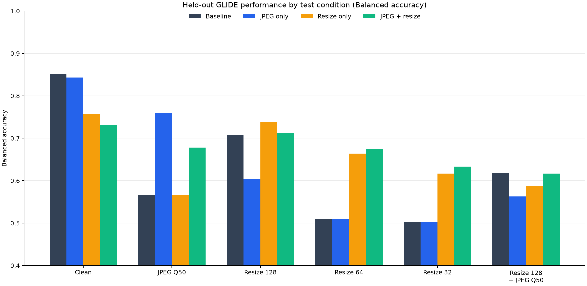
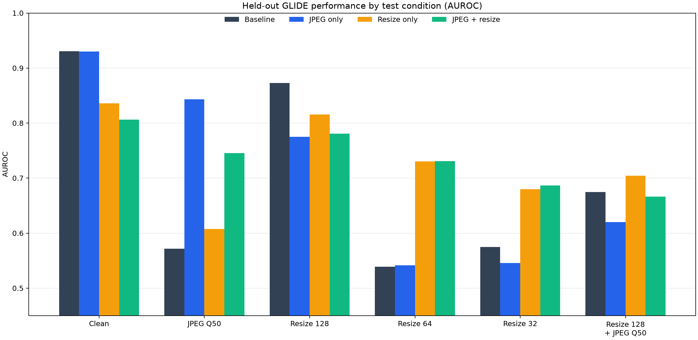

# SC4001: AI-Generated Image Detection

## Current work

The current experiment fine-tunes an ImageNet-pretrained ResNet-18 to distinguish real ImageNet photographs from AI-generated images. It tests whether the model transfers to a generator it did not see during training: **GLIDE is held out entirely**, and six other generator categories are used to fit the model and select its decision threshold.

The first study compares a standard training setup with artifact augmentations. Follow-up ablations train with JPEG augmentation alone and downsampling augmentation alone. The experiment varies training augmentation while keeping the held-out generator, split, seed, training duration, and test conditions fixed.

A teammate's CIFAKE model was mentioned as parallel project work. Its configuration and result files are not included in this repository snapshot, so the tables below cover only the ImageNet-AI ResNet runs documented here.

### Current held-out results

Balanced accuracy on 500 real and 500 GLIDE-generated images per test condition:

| Test condition | Baseline | JPEG only | Resize only | JPEG + resize |
|---|---:|---:|---:|---:|
| Clean | 85.1% | 84.3% | 75.7% | 73.2% |
| JPEG quality 50 | 56.7% | **76.0%** | 56.6% | 67.8% |
| Resize to 128 px | 70.8% | 60.3% | 73.8% | 71.2% |
| Resize to 64 px | 51.0% | 51.0% | 66.4% | **67.5%** |
| Resize to 32 px | 50.3% | 50.2% | 61.7% | **63.3%** |
| Resize to 128 px + JPEG 50 | **61.8%** | 56.3% | 58.8% | 61.7% |



AUROC is included because it measures score ranking without relying on a single classification threshold:

| Test condition | Baseline | JPEG only | Resize only | JPEG + resize |
|---|---:|---:|---:|---:|
| Clean | 0.931 | 0.930 | 0.836 | 0.806 |
| JPEG quality 50 | 0.572 | **0.843** | 0.608 | 0.745 |
| Resize to 128 px | **0.873** | 0.775 | 0.815 | 0.781 |
| Resize to 64 px | 0.539 | 0.542 | 0.731 | 0.731 |
| Resize to 32 px | 0.575 | 0.546 | 0.680 | 0.687 |
| Resize to 128 px + JPEG 50 | 0.675 | 0.620 | **0.704** | 0.666 |



**Early interpretation:** augmentation effects are distortion-specific. JPEG-only training markedly improves JPEG-Q50 detection while preserving clean AUROC. Resize augmentation improves detection after stronger downsampling, with a clean-image performance cost. These are preliminary results from one held-out generator and one seed, not a conclusion about all generators.

For the full protocol, detailed metrics, training curves, experiment history, limitations, and follow-up questions, see the [detailed report](REPORT.md). The shorter [experiment notes](RESNET_EXPERIMENT.md) document the current setup and commands.

See [PROJECT_STRUCTURE.md](PROJECT_STRUCTURE.md) for the cleaned folder hierarchy and a guide to the model, dataset, script, config, and notebook files.

## Dataset and split

GenImage is now stored at `dataset/image/training/GenImage`, preserving the original seven generator folders and their `train`/`val` splits. The current held-out GLIDE test copy is at `dataset/image/test/GenImage/imagenet_glide/test`. CIFAKE is not present locally yet; its expected train/test folders are documented in `dataset/image/README.md`.

```text
dataset/image/
├── training/
│   ├── GenImage/<generator>/{train,val}/{ai,nature}/
│   └── CiFake/train/{REAL,FAKE}/
└── test/
    ├── GenImage/<held-out-generator>/test/{ai,nature}/
    └── CiFake/test/{REAL,FAKE}/
```

The ResNet script defaults to the GenImage training/validation root and the separate GenImage test root shown above. For another generator holdout, place its test images under the matching `test/GenImage/<generator>/test/` directory or provide `--test-data-root` and `--test-split` explicitly. CIFAKE is configured as a local dataset under `dataset/image`; place its original train/test category folders at the paths above before running RIGID evaluation or embedding extraction.

Seven generator folders are available:

- `imagenet_ai_0419_biggan`
- `imagenet_ai_0419_vqdm`
- `imagenet_ai_0424_sdv5`
- `imagenet_ai_0424_wukong`
- `imagenet_ai_0508_adm`
- `imagenet_glide` (held out for this experiment)
- `imagenet_midjourney`

Each contains `train` and `val` splits, with `ai` and `nature` image categories. The ImageNet real photographs are shared between generator folders; the experiment counts them once.

For the GLIDE holdout:

- **Fit:** 13,600 images: 12,000 generated images from the six seen generators and 1,600 real train images.
- **Validation and threshold selection:** 3,400 images: 3,000 generated validation images from the seen generators and 400 real train images reserved from the real training photos.
- **Final test:** 1,000 GLIDE validation images: 500 real and 500 generated.

The held-out generator is excluded from both training and threshold/model selection. Real validation photos were reserved from the training split because the validation photos are shared across the generator directories; this prevents overlap between calibration and the held-out test images.

## Reproducing the experiment

The training script uses the new `dataset/image` layout by default. It uses Python 3.12, PyTorch, torchvision, Pillow, scikit-learn, NumPy, and tqdm. The project dependencies are listed in `pyproject.toml`; the recorded runs used CUDA-enabled PyTorch 2.15.0+cu132 and torchvision 0.29.2+cu132 on an NVIDIA RTX 4050 Laptop GPU.

From the repository directory on Windows, after setting up the environment and dataset:

```powershell
.venv\Scripts\python.exe scripts\train_resnet_generalization.py `
  --held-out imagenet_glide --epochs 8 --batch-size 32 --workers 4

.venv\Scripts\python.exe scripts\train_resnet_generalization.py `
  --held-out imagenet_glide --epochs 8 --batch-size 32 --workers 4 `
  --augmentation jpeg

.venv\Scripts\python.exe scripts\train_resnet_generalization.py `
  --held-out imagenet_glide --epochs 8 --batch-size 32 --workers 4 `
  --augmentation resize

.venv\Scripts\python.exe scripts\train_resnet_generalization.py `
  --held-out imagenet_glide --epochs 8 --batch-size 32 --workers 4 `
  --augmentation both
```

The legacy `--robust-augmentation` option is an alias for `--augmentation both`. Choose another generator with `--held-out <generator-folder>` to start a new leave-one-generator-out run. Use `--eval-only` to score an existing local checkpoint again.

After new runs, regenerate the figures and portable result summaries from the four documented GLIDE runs with:

```powershell
.venv\Scripts\python.exe scripts\make_report_assets.py
```

Once CIFAKE has been placed under `dataset/image/training/CiFake` and `dataset/image/test/CiFake`, run the frozen DINOv2/RIGID test evaluation with:

```powershell
.venv\Scripts\python.exe scripts\evaluate.py --config configs\cifake.yaml
```

The base DINOv2 weights are fetched by `torch.hub` on first use and cached under `model/DINOv2/Frozen DINO model/torch_hub/`. This CIFAKE config scores up to 1,000 images per class from the test split; it does not train RIGID or a probe.

### Frozen DINOv2 / RIGID on the same holdout (in progress)

`scripts/dinov2_genimage_holdout.py` evaluates the frozen-DINOv2 detectors on exactly the ResNet protocol above. It imports the split, test conditions, threshold rule, and metrics from `train_resnet_generalization.py`, so it uses the same fit/validation/test images and the same seed. It runs four detectors on one frozen DINOv2 ViT-L/14 backbone: plain RIGID (no training), a logistic-regression probe on the clean embedding, and logistic-regression and MLP probes on clean + (noisy − clean), which is the probe from `rigid_probe.py`. Images use the ResNet eval preprocessing (shorter side 256, center crop 224) unless `--preprocess squash` is given.

```bash
python scripts/dinov2_genimage_holdout.py --held-out imagenet_glide
python scripts/dinov2_genimage_holdout.py --held-out imagenet_glide --augmentation jpeg
python scripts/compare_holdout_results.py --held-out imagenet_glide
```

Each detector writes `results/dinov2_<detector>[_<augmentation>]_holdout_<generator>/{summary.json,test_scores.csv}` in the ResNet format. `compare_holdout_results.py` puts every ResNet and DINOv2 run for one holdout into Markdown tables at `results/comparison_holdout_<generator>.md`. Embeddings are cached in `results/dinov2_embeddings/`, and fitted probes in `model/DINOv2/Frozen DINO model/checkpoints/`; both are git-ignored. `--augmentation` applies the ResNet study's JPEG/resize artifacts once to the fit images before embedding. `--model-name dinov2_vitb14` gives a faster backbone, and `--max-per-group N` gives a quick subset run whose results are tagged and left out of the comparison by default.

#### Leave-one-generator-out (all 7 generators)

`python scripts/dinov2_genimage_holdout.py --held-out all` repeats the same protocol with each generator held out in turn, and `python scripts/summarize_logo.py` averages the holdouts into `results/logo_summary.md`. Mean balanced accuracy over the seven holdouts (BigGAN, VQDM, SD v1.5, Wukong, ADM, GLIDE, Midjourney), with the worst holdout in brackets:

| Detector | Clean | JPEG Q50 | Resize 128 | Resize 64 | Resize 32 | 128 + JPEG 50 |
|---|---:|---:|---:|---:|---:|---:|
| RIGID (no training) | 75.9% [64.9] | 69.1% [57.2] | 70.3% [56.7] | 57.3% [49.5] | 50.0% [49.6] | 54.4% [47.4] |
| Logistic regression, clean | 80.5% [68.6] | **74.8%** [62.4] | 77.9% [66.8] | 73.1% [64.7] | **63.8%** [58.9] | **70.1%** [56.1] |
| Logistic regression, clean + diff | 83.0% [74.4] | 71.5% [59.7] | 78.6% [70.4] | 70.2% [63.5] | 58.7% [53.7] | 64.4% [53.6] |
| MLP, clean + diff | **85.3%** [76.6] | 74.7% [64.2] | **81.5%** [73.7] | **74.1%** [68.2] | 61.6% [56.5] | 68.1% [56.5] |

The MLP on clean + (noisy − clean) features has the best clean balanced accuracy on six of seven holdouts and the best clean AUROC on all seven. Under strong degradation (32 px, 128 px + JPEG) the probe on clean features alone degrades least, consistent with the noise-sensitivity signal relying on high-frequency detail. RIGID without training is strong on BigGAN and GLIDE but weak on the Stable Diffusion family and Midjourney, and falls to chance at 32 px. ADM and Midjourney are the hardest held-out generators (best clean balanced accuracy 76.6% and 78.1%). Per-holdout tables with bootstrap intervals are in `results/comparison_holdout_<generator>.md`, and per-class recall, error overlap, and failure montages in `results/analysis_holdout_<generator>.md` and `reports/figures/<generator>_*.png`. ResNet has so far been run only with GLIDE held out.

GenImage has a format confound: in every generator folder the real photos are high-quality JPEGs (luminance DC quantization step 1) at varied sizes, while the generated images are PNGs at one fixed size per generator. The recall tables show detectors exploiting it. JPEG-compressing generated test images makes them look real to the ResNet and to the clean + diff probes, and downsampling real photos makes them look generated.

#### Follow-up experiments on cached embeddings

`python scripts/cached_probe_experiments.py e3|e4` reruns the probes on the cached embeddings only (no backbone pass); full tables are in `results/e3_family_holdout.md` and `results/e4_probe_routing.md`. Both reproduce the leave-one-generator-out numbers above exactly before changing anything.

**E3: leave-one-family-out.** SD v1.5 and Wukong are both Stable Diffusion models, so holding out one still trains on its sibling. Removing both from training lowers clean balanced accuracy on the held-out SD generator by 2.9–5.8 pp for every probe (all significant; MLP: SD v1.5 85.6% → 82.5%, Wukong 86.5% → 82.1%). A size control that removes one non-SD generator instead changes almost nothing (MLP 85.2% and 86.3%), so the drop comes from the missing sibling, not from training on one generator fewer. Training-free RIGID is unchanged, confirming the test set is identical. Leave-one-generator-out therefore overstates generalisation to a genuinely new model family by about 3–6 pp.

**E4: degradation-aware routing.** The clean+diff MLP is best on clean images and the clean-only logistic regression under strong degradation. A router picks, per degradation type, the MLP, the logistic regression, or their logit average, and its threshold, by balanced accuracy on the six *seen* generators' validation images degraded the same way. Mean over the 7 holdouts:

| Method | Clean | JPEG Q50 | Resize 128 | Resize 64 | Resize 32 | 128 + JPEG 50 | Mean |
|---|---:|---:|---:|---:|---:|---:|---:|
| MLP, clean + diff | **85.3%** | 74.7% | 81.5% | 74.1% | 61.6% | 68.1% | 74.2% |
| Logistic regression, clean | 80.5% | 74.8% | 77.9% | 73.1% | 63.8% | 70.1% | 73.4% |
| Logit average of both | 83.5% | 76.5% | 80.3% | 74.0% | 63.8% | 70.7% | 74.8% |
| Router | 85.1% | **76.3%** | **82.0%** | **74.8%** | **64.6%** | **71.1%** | **75.7%** |

The router matches the MLP on clean images (−0.2 pp, not significant) and beats it under JPEG (+1.5 pp), 32 px (+3.1 pp), and 128 px + JPEG (+3.1 pp), all significant in a paired bootstrap; it beats the clean-only probe in every condition. Under strong degradation it chooses the logit average rather than switching to the clean-only probe, so the two probes carry complementary information. Re-picking only the threshold helps mainly under JPEG (+2.5 pp for the MLP) and little elsewhere, so the remaining degradation gap is in the features, not in the decision threshold. The router needs the degradation type at test time (image size and JPEG quality are readable from the file) but never sees the held-out generator.

If downloading the DINOv2 weights fails (in November 2026 the TLS certificate of `dl.fbaipublicfiles.com` had expired), copy an existing `dinov2_vitl14_pretrain.pth`, for example from `~/.cache/torch/hub/checkpoints/` on a machine that has already run RIGID, into `model/DINOv2/Frozen DINO model/torch_hub/checkpoints/`.

Update the README and report tables when adding a new holdout or experiment. Result summaries, per-image scores, and training histories are small text files and can be published to GitHub. Model checkpoints are excluded by `.gitignore` because each is about 43 MB; the image dataset and local virtual environment should also remain outside the repository. The score CSV paths are dataset-relative and do not expose local machine paths.

## Repository map

- `scripts/train_resnet_generalization.py` — training, validation, calibration, held-out evaluation, and score export.
- `scripts/make_report_assets.py` — sanitizes result paths and regenerates the plotted figures.
- `scripts/dinov2_genimage_holdout.py` — frozen DINOv2 RIGID and probe detectors on the same generator holdout.
- `scripts/compare_holdout_results.py` — side-by-side tables of all ResNet and DINOv2 runs for one holdout, with paired stratified bootstrap 95% intervals and differences against a reference run.
- `scripts/failure_analysis.py` — format/resolution confound check, per-class recall, error overlap, score-shift histograms, and most-confident-mistake montages from saved test scores.
- `scripts/summarize_logo.py` — leave-one-generator-out averages across every finished holdout.
- `scripts/cached_probe_experiments.py` — leave-one-family-out (E3) and degradation-aware probe routing (E4) on cached embeddings.
- `REPORT.md` — detailed, ongoing experiment report.
- `PROJECT_STRUCTURE.md` — folder tree and guide to the code, configs, notebooks, and result files.
- `RESNET_EXPERIMENT.md` — concise experimental setup and ablation notes.
- `results/` — per-run summaries, per-image scores, and training histories; local checkpoints are ignored.
- `model/ResNet/Frozen Resnet model/` — ImageNet initialization and fine-tuned ResNet checkpoints.
- `model/DINOv2/Frozen DINO model/` — cached DINOv2 backbone and saved DINOv2 feature probes.
- `dataset/image/` — organized GenImage and CIFAKE image data.

The model folder layout is:

```text
model/
├── ResNet/Frozen Resnet model/
│   ├── torch_hub/checkpoints/resnet18-f37072fd.pth
│   └── checkpoints/<run-name>/best_model.pt
└── DINOv2/Frozen DINO model/
    ├── torch_hub/        # downloaded DINOv2 source and frozen weights
    └── probes/           # saved logistic-regression and MLP probes
```

The DINOv2 backbone cache is populated on first use. It is not currently stored in the workspace; its path is now fixed under the model folder.

## Ongoing work

This is a working research record, not a finished claim. Potential next steps include repeating the comparison with multiple random seeds, rotating the held-out generator, exploring less costly resize augmentation, and inspecting errors by generator and image category. Add future runs to the report with the holdout, seed, split, training settings, threshold calibration method, and all tested conditions so comparisons remain interpretable.
