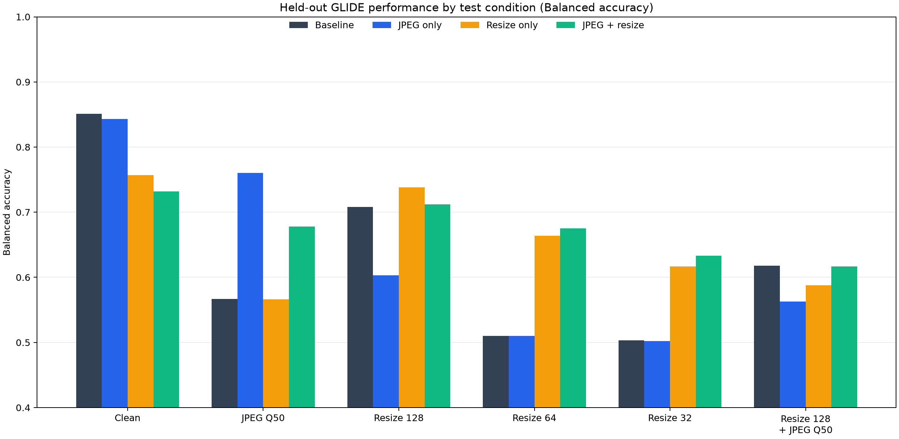
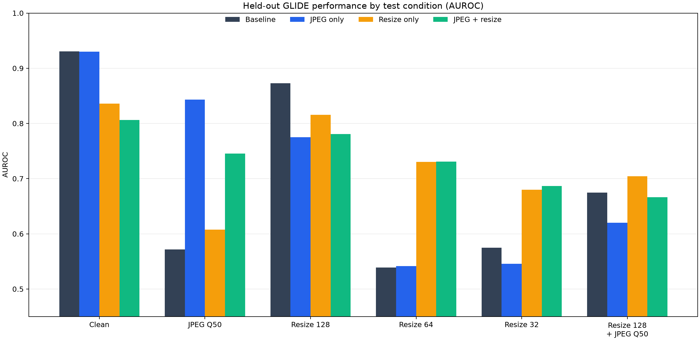

# SC4001: AI-Generated Image Detection

## Current work

The current experiment fine-tunes an ImageNet-pretrained ResNet-18 to distinguish real ImageNet photographs from AI-generated images. It tests whether the model transfers to a generator it did not see during training: **GLIDE is held out entirely**, and six other generator categories are used to fit the model and select its decision threshold.

The first study compares a standard training setup with artifact augmentations. Follow-up ablations train with JPEG augmentation alone and downsampling augmentation alone. The experiment varies training augmentation while keeping the held-out generator, split, seed, training duration, and test conditions fixed.

A teammate's CIFAKE model was mentioned as parallel project work. Its configuration and result files are not included in this repository snapshot, so the tables below cover only the ImageNet-AI ResNet runs documented here.

### Current held-out results

Balanced accuracy on 500 real and 500 GLIDE-generated images per test condition:

| Test condition | Baseline | JPEG only | Resize only | JPEG + resize |
|---|---:|---:|---:|---:|
| Clean | 85.1% | 84.3% | 75.7% | 73.2% |
| JPEG quality 50 | 56.7% | **76.0%** | 56.6% | 67.8% |
| Resize to 128 px | 70.8% | 60.3% | 73.8% | 71.2% |
| Resize to 64 px | 51.0% | 51.0% | 66.4% | **67.5%** |
| Resize to 32 px | 50.3% | 50.2% | 61.7% | **63.3%** |
| Resize to 128 px + JPEG 50 | **61.8%** | 56.3% | 58.8% | 61.7% |



AUROC is included because it measures score ranking without relying on a single classification threshold:

| Test condition | Baseline | JPEG only | Resize only | JPEG + resize |
|---|---:|---:|---:|---:|
| Clean | 0.931 | 0.930 | 0.836 | 0.806 |
| JPEG quality 50 | 0.572 | **0.843** | 0.608 | 0.745 |
| Resize to 128 px | **0.873** | 0.775 | 0.815 | 0.781 |
| Resize to 64 px | 0.539 | 0.542 | 0.731 | 0.731 |
| Resize to 32 px | 0.575 | 0.546 | 0.680 | 0.687 |
| Resize to 128 px + JPEG 50 | 0.675 | 0.620 | **0.704** | 0.666 |



**Early interpretation:** augmentation effects are distortion-specific. JPEG-only training markedly improves JPEG-Q50 detection while preserving clean AUROC. Resize augmentation improves detection after stronger downsampling, with a clean-image performance cost. These are preliminary results from one held-out generator and one seed, not a conclusion about all generators.

For the full protocol, detailed metrics, training curves, experiment history, limitations, and follow-up questions, see the [detailed report](REPORT.md). The shorter [experiment notes](RESNET_EXPERIMENT.md) document the current setup and commands.

See [PROJECT_STRUCTURE.md](PROJECT_STRUCTURE.md) for the cleaned folder hierarchy and a guide to the model, dataset, script, config, and notebook files.

## Dataset and split

GenImage is now stored at `dataset/image/training/GenImage`, preserving the original seven generator folders and their `train`/`val` splits. The current held-out GLIDE test copy is at `dataset/image/test/GenImage/imagenet_glide/test`. CIFAKE is not present locally yet; its expected train/test folders are documented in `dataset/image/README.md`.

```text
dataset/image/
├── training/
│   ├── GenImage/<generator>/{train,val}/{ai,nature}/
│   └── CiFake/train/{REAL,FAKE}/
└── test/
    ├── GenImage/<held-out-generator>/test/{ai,nature}/
    └── CiFake/test/{REAL,FAKE}/
```

The ResNet script defaults to the GenImage training/validation root and the separate GenImage test root shown above. For another generator holdout, place its test images under the matching `test/GenImage/<generator>/test/` directory or provide `--test-data-root` and `--test-split` explicitly. CIFAKE is configured as a local dataset under `dataset/image`; place its original train/test category folders at the paths above before running RIGID evaluation or embedding extraction.

Seven generator folders are available:

- `imagenet_ai_0419_biggan`
- `imagenet_ai_0419_vqdm`
- `imagenet_ai_0424_sdv5`
- `imagenet_ai_0424_wukong`
- `imagenet_ai_0508_adm`
- `imagenet_glide` (held out for this experiment)
- `imagenet_midjourney`

Each contains `train` and `val` splits, with `ai` and `nature` image categories. The ImageNet real photographs are shared between generator folders; the experiment counts them once.

For the GLIDE holdout:

- **Fit:** 13,600 images: 12,000 generated images from the six seen generators and 1,600 real train images.
- **Validation and threshold selection:** 3,400 images: 3,000 generated validation images from the seen generators and 400 real train images reserved from the real training photos.
- **Final test:** 1,000 GLIDE validation images: 500 real and 500 generated.

The held-out generator is excluded from both training and threshold/model selection. Real validation photos were reserved from the training split because the validation photos are shared across the generator directories; this prevents overlap between calibration and the held-out test images.

## Reproducing the experiment

The training script uses the new `dataset/image` layout by default. It uses Python 3.12, PyTorch, torchvision, Pillow, scikit-learn, NumPy, and tqdm. The project dependencies are listed in `pyproject.toml`; the recorded runs used CUDA-enabled PyTorch 2.15.0+cu132 and torchvision 0.29.2+cu132 on an NVIDIA RTX 4050 Laptop GPU.

From the repository directory on Windows, after setting up the environment and dataset:

```powershell
.venv\Scripts\python.exe scripts\train_resnet_generalization.py `
  --held-out imagenet_glide --epochs 8 --batch-size 32 --workers 4

.venv\Scripts\python.exe scripts\train_resnet_generalization.py `
  --held-out imagenet_glide --epochs 8 --batch-size 32 --workers 4 `
  --augmentation jpeg

.venv\Scripts\python.exe scripts\train_resnet_generalization.py `
  --held-out imagenet_glide --epochs 8 --batch-size 32 --workers 4 `
  --augmentation resize

.venv\Scripts\python.exe scripts\train_resnet_generalization.py `
  --held-out imagenet_glide --epochs 8 --batch-size 32 --workers 4 `
  --augmentation both
```

The legacy `--robust-augmentation` option is an alias for `--augmentation both`. Choose another generator with `--held-out <generator-folder>` to start a new leave-one-generator-out run. Use `--eval-only` to score an existing local checkpoint again.

After new runs, regenerate the figures and portable result summaries from the four documented GLIDE runs with:

```powershell
.venv\Scripts\python.exe scripts\make_report_assets.py
```

Once CIFAKE has been placed under `dataset/image/training/CiFake` and `dataset/image/test/CiFake`, run the frozen DINOv2/RIGID test evaluation with:

```powershell
.venv\Scripts\python.exe scripts\evaluate.py --config configs\cifake.yaml
```

The base DINOv2 weights are fetched by `torch.hub` on first use and cached under `model/DINOv2/Frozen DINO model/torch_hub/`. This CIFAKE config scores up to 1,000 images per class from the test split; it does not train RIGID or a probe.

### Frozen DINOv2 / RIGID on the same holdout (in progress)

`scripts/dinov2_genimage_holdout.py` evaluates the frozen-DINOv2 detectors on exactly the ResNet protocol above. It imports the split, test conditions, threshold rule, and metrics from `train_resnet_generalization.py`, so it uses the same fit/validation/test images and the same seed. It runs four detectors on one frozen DINOv2 ViT-L/14 backbone: plain RIGID (no training), a logistic-regression probe on the clean embedding, and logistic-regression and MLP probes on clean + (noisy − clean), which is the probe from `rigid_probe.py`. Images use the ResNet eval preprocessing (shorter side 256, center crop 224) unless `--preprocess squash` is given.

```bash
python scripts/dinov2_genimage_holdout.py --held-out imagenet_glide
python scripts/dinov2_genimage_holdout.py --held-out imagenet_glide --augmentation jpeg
python scripts/compare_holdout_results.py --held-out imagenet_glide
```

Each detector writes `results/dinov2_<detector>[_<augmentation>]_holdout_<generator>/{summary.json,test_scores.csv}` in the ResNet format. `compare_holdout_results.py` puts every ResNet and DINOv2 run for one holdout into Markdown tables at `results/comparison_holdout_<generator>.md`. Embeddings are cached in `results/dinov2_embeddings/`, and fitted probes in `model/DINOv2/Frozen DINO model/checkpoints/`; both are git-ignored. `--augmentation` applies the ResNet study's JPEG/resize artifacts once to the fit images before embedding. `--model-name dinov2_vitb14` gives a faster backbone, and `--max-per-group N` gives a quick subset run whose results are tagged and left out of the comparison by default.

#### Leave-one-generator-out (all 7 generators)

`python scripts/dinov2_genimage_holdout.py --held-out all` repeats the same protocol with each generator held out in turn, and `python scripts/summarize_logo.py` averages the holdouts into `results/logo_summary.md`. Mean balanced accuracy over the seven holdouts (BigGAN, VQDM, SD v1.5, Wukong, ADM, GLIDE, Midjourney), with the worst holdout in brackets:

| Detector | Clean | JPEG Q50 | Resize 128 | Resize 64 | Resize 32 | 128 + JPEG 50 |
|---|---:|---:|---:|---:|---:|---:|
| RIGID (no training) | 75.9% [64.9] | 69.1% [57.2] | 70.3% [56.7] | 57.3% [49.5] | 50.0% [49.6] | 54.4% [47.4] |
| Logistic regression, clean | 80.5% [68.6] | **74.8%** [62.4] | 77.9% [66.8] | 73.1% [64.7] | **63.8%** [58.9] | **70.1%** [56.1] |
| Logistic regression, clean + diff | 83.0% [74.4] | 71.5% [59.7] | 78.6% [70.4] | 70.2% [63.5] | 58.7% [53.7] | 64.4% [53.6] |
| MLP, clean + diff | **85.3%** [76.6] | 74.7% [64.2] | **81.5%** [73.7] | **74.1%** [68.2] | 61.6% [56.5] | 68.1% [56.5] |

The MLP on clean + (noisy − clean) features has the best clean balanced accuracy on six of seven holdouts and the best clean AUROC on all seven. Under strong degradation (32 px, 128 px + JPEG) the probe on clean features alone degrades least, consistent with the noise-sensitivity signal relying on high-frequency detail. RIGID without training is strong on BigGAN and GLIDE but weak on the Stable Diffusion family and Midjourney, and falls to chance at 32 px. ADM and Midjourney are the hardest held-out generators (best clean balanced accuracy 76.6% and 78.1%). Per-holdout tables with bootstrap intervals are in `results/comparison_holdout_<generator>.md`, and per-class recall, error overlap, and failure montages in `results/analysis_holdout_<generator>.md` and `reports/figures/<generator>_*.png`. ResNet has so far been run only with GLIDE held out.

GenImage has a format confound: in every generator folder the real photos are high-quality JPEGs (luminance DC quantization step 1) at varied sizes, while the generated images are PNGs at one fixed size per generator. The recall tables show detectors exploiting it. JPEG-compressing generated test images makes them look real to the ResNet and to the clean + diff probes, and downsampling real photos makes them look generated.

#### Follow-up experiments on cached embeddings

`python scripts/cached_probe_experiments.py e3|e4|a1|a3|a4` reruns the probes on the cached embeddings only (no backbone pass); full tables are in `results/e3_family_holdout.md`, `results/e4_probe_routing.md`, `results/a1_family_holdout.md`, `results/a3_predicted_degradation_router.md` and `results/a4_seed_robustness.md`. All reproduce the leave-one-generator-out numbers above exactly before changing anything.

**E3: leave-one-family-out.** SD v1.5 and Wukong are both Stable Diffusion models, so holding out one still trains on its sibling. Removing both from training lowers clean balanced accuracy on the held-out SD generator by 2.9–5.8 pp for every probe (all significant; MLP: SD v1.5 85.6% → 82.5%, Wukong 86.5% → 82.1%). A size control that removes one non-SD generator instead changes almost nothing (MLP 85.2% and 86.3%), so the drop comes from the missing sibling, not from training on one generator fewer. Training-free RIGID is unchanged, confirming the test set is identical. Leave-one-generator-out therefore overstates generalisation to a genuinely new model family by about 3–6 pp.

**E4: degradation-aware routing.** The clean+diff MLP is best on clean images and the clean-only logistic regression under strong degradation. A router picks, per degradation type, the MLP, the logistic regression, or their logit average, and its threshold, by balanced accuracy on the six *seen* generators' validation images degraded the same way. Mean over the 7 holdouts:

| Method | Clean | JPEG Q50 | Resize 128 | Resize 64 | Resize 32 | 128 + JPEG 50 | Mean |
|---|---:|---:|---:|---:|---:|---:|---:|
| MLP, clean + diff | **85.3%** | 74.7% | 81.5% | 74.1% | 61.6% | 68.1% | 74.2% |
| Logistic regression, clean | 80.5% | 74.8% | 77.9% | 73.1% | 63.8% | 70.1% | 73.4% |
| Logit average of both | 83.5% | 76.5% | 80.3% | 74.0% | 63.8% | 70.7% | 74.8% |
| Router | 85.1% | **76.3%** | **82.0%** | **74.8%** | **64.6%** | **71.1%** | **75.7%** |

The router matches the MLP on clean images (−0.2 pp, not significant) and beats it under JPEG (+1.5 pp), 32 px (+3.1 pp), and 128 px + JPEG (+3.1 pp), all significant in a paired bootstrap; it beats the clean-only probe in every condition. Under strong degradation it chooses the logit average rather than switching to the clean-only probe, so the two probes carry complementary information. Re-picking only the threshold helps mainly under JPEG (+2.5 pp for the MLP) and little elsewhere, so the remaining degradation gap is in the features, not in the decision threshold. The router needs the degradation type at test time (image size and JPEG quality are readable from the file) but never sees the held-out generator.

**A3: router with a predicted degradation type** (`a3`, `results/a3_predicted_degradation_router.md`). This removes E4's one assumption. A multinomial logistic regression on the same DINOv2 features predicts each test image's degradation type. It is trained on the seen generators' degraded validation images, the same images the router already uses. Each image is then scored with the probe and threshold the router picked for the *predicted* type.
- The classifier is 83% accurate on the held-out generators. Its errors are mostly between neighbouring conditions (clean ↔ resize 128 ↔ JPEG), and the router picks nearly the same probe for those.
- Mean balanced accuracy is 75.4%, versus 75.7% with the true type and 74.2% for the MLP alone.
- The predicted-type router keeps the significant gains over the MLP at 32 px (+3.2 pp) and 128 px + JPEG (+2.6 pp), and a smaller one at JPEG Q50 (+0.9 pp, compared with +1.5 pp when the type is given).
- On clean images it is within 0.3 pp of the MLP, which is not significant.
- It beats the clean-only logistic regression in every condition; the JPEG Q50 and 128 px + JPEG gains are not significant.

The routing needs nothing but the image.

**A1: leave-one-family-out for every family** (`a1`, `results/a1_family_holdout.md`). This extends E3 to all five families: GAN (BigGAN), VQ diffusion (VQDM), latent diffusion (SD v1.5, Wukong), OpenAI pixel-space diffusion (ADM, GLIDE), and Midjourney. For each generator, its whole family is removed from training. For a single-generator family this is just the leave-one-generator-out run. The family-level 7-generator means below are the more honest headline numbers:

| Detector | Clean | JPEG Q50 | Resize 128 | Resize 64 | Resize 32 | 128 + JPEG 50 |
|---|---:|---:|---:|---:|---:|---:|
| Logistic regression, clean | 79.3% (−1.2*) | 73.1% (−1.8*) | 77.2% (−0.7*) | 72.4% (−0.7*) | 63.3% (−0.5) | 68.5% (−1.6*) |
| Logistic regression, clean + diff | 81.2% (−1.8*) | 68.3% (−3.2*) | 77.6% (−1.0*) | 70.2% (+0.0) | 58.5% (−0.2) | 62.6% (−1.8*) |
| MLP, clean + diff | **84.2%** (−1.1*) | 72.2% (−2.5*) | 80.3% (−1.3*) | 73.0% (−1.1*) | 60.9% (−0.7*) | 66.8% (−1.3*) |

Brackets show the change from leave-one-generator-out (* = paired-bootstrap 95% interval excludes 0). The probe ranking is unchanged. ADM and GLIDE behave differently from the Stable Diffusion pair. Removing GLIDE costs the MLP only 1.3 pp on ADM, which is not significant, and the size control explains it entirely (B − C = +0.5 pp). Removing ADM does not hurt GLIDE at all (+1.0 pp). Shared lineage therefore does not guarantee shared artifacts: the two latent-diffusion models are near-duplicates in DINOv2 feature space, while the two OpenAI pixel-diffusion models are not.

**A4: training-seed robustness** (`a4`, `results/a4_seed_robustness.md`). The MLP was refit with five seeds (42, 1, 2, 3, 4). The seed changes only the initialisation and the early-stopping split. The standard deviation of the 7-generator mean balanced accuracy over seeds is 0.2–0.4 pp, except 0.9 pp at JPEG Q50; on single generators it is 0.3–1.3 pp. These differences keep their sign on all five seeds:
- MLP − clean-only logistic regression on clean images: +4.7 ± 0.2 pp.
- MLP − clean + diff logistic regression: +2.2 to +3.7 pp in every condition.
- Router − MLP: +2.2 (JPEG), +1.2 (64 px), +2.9 (32 px) and +3.1 pp (128 + JPEG).
- Router − clean-only logistic regression in every condition.

Two comparisons are within seed noise: MLP vs. clean-only logistic regression at JPEG Q50 (−0.3 ± 0.9 pp, sign agrees on 3 of 5 seeds), and router vs. MLP on clean images (−0.0 ± 0.2 pp).

#### Format-confound experiments (new embeddings)

`python scripts/format_alignment_experiments.py b1|b2` adds two test conditions that put **both** classes through the same format pipeline:
- **Format q96:** JPEG quality 96 with 4:4:4 chroma at native size. This is the setting of almost all real photos in tiny-GenImage.
- **Format 256+q96:** resize the shorter side to 256, then JPEG q96, so neither compression nor size separates the classes.

Real photos are thereby JPEG-compressed twice and generated images once. Full tables are in `results/e1_format_matched_test.md` and `results/e2_format_aligned_training.md`. The first embedding run takes about 80 minutes on an M-series Mac and adds about 32,000 cached embeddings. The clean results reproduce the main runs exactly.

**E1: format-matched test set.** With the main runs' probes and thresholds, matching the format lowers the MLP's 7-generator mean balanced accuracy from 85.3% to 83.3% (q96) and to 82.5% (256+q96). Both drops are significant, as are those of every other detector. Mean AUROC falls only from 0.927 to 0.916. Real recall rises from 87% to 93% and generated recall falls from 83% to 72%. So once generated images are JPEG-compressed like real photos they look more real, which is the "compressed means real" shortcut. Most of the clean accuracy survives, but the effect depends on the generator. BigGAN, VQDM, ADM and GLIDE are essentially unaffected (−2.4 to +1.7 pp). The large-image generators lose the most: SD v1.5 85.6% → 81.0%, Wukong 86.5% → 80.9%, Midjourney 78.1% → 68.6%. Their AUROC also drops (Midjourney 0.879 → 0.823), so this is lost ranking, not only a threshold shift.

**E2: format-aligned training.** Refitting the probes on seen-generator images whose real and generated images both went through Format 256+q96 removes that dependence. Mean over the 7 holdouts:

| MLP, clean + diff | Clean (raw files) | JPEG Q50 | Resize 32 | Format 256+q96 | SD v1.5 / Wukong / Midjourney at 256+q96 |
|---|---:|---:|---:|---:|---:|
| Clean-trained (main runs) | **85.3%** | 74.7% | 61.6% | 82.5% | 81.0% / 80.9% / 68.6% |
| Format-aligned training | 83.6% (−1.7*) | 74.5% (−0.2) | 61.0% (−0.6) | **84.8%** (+2.3*) | 83.6% / 85.2% / 75.6% |

On the format-matched test set, aligned training recovers most of the loss: +2.3 pp for the MLP and +4.2 pp for the clean + diff logistic regression, with gains of 2.6–7.0 pp on the large-image generators. Its accuracy is about the same on raw and format-matched files (83.6% vs. 84.8%). On the raw test files it is 1.7 pp worse on clean images and 1.3–1.6 pp worse at 128 px, 64 px and 128 px + JPEG, though no worse under JPEG Q50 or 32 px.

Taken together, about 2–3 pp of the clean-trained probe's mean accuracy, and up to 10 pp for Midjourney, depends on the PNG-versus-JPEG format difference. A format-independent estimate of how well frozen DINOv2 generalises to unseen generators is about 84–85% mean balanced accuracy. Aligned training does not improve robustness to the six standard degradations; it trades about 1.7 pp on raw benchmark files for a detector whose accuracy does not depend on the file format. RIGID has nothing to retrain, and its threshold chosen on aligned images transfers worse to raw files (−2.7 pp clean).

#### Backbone and layer comparison (CLIP, intermediate DINOv2 layers)

`python scripts/backbone_features.py` embeds every needed image once, with one decode pass feeding two frozen ViT-L/14 backbones. It stores the DINOv2 CLS and mean patch tokens after blocks 8, 12, 16, 20 and 24, and the OpenAI CLIP image embedding, the backbone of UnivFD. The features cover the 6 standard conditions and Format 256+q96: about 67,000 images, 1.4 GB in `results/backbone_embeddings/` (git-ignored), and about 2.5 h on an M-series Mac. It needs `pip install open_clip_torch`.

`python scripts/backbone_comparison.py` then fits the same logistic-regression and MLP probes under the main protocol and writes `results/backbone_comparison.md`. Layer-24 logistic regression reproduces the main runs' `logreg_clean` exactly on every holdout. Mean balanced accuracy over the 7 holdouts:

| Features, probe | Clean | JPEG Q50 | Resize 128 | Resize 64 | Resize 32 | 128 + JPEG | Format 256+q96 | Family out | Seen val |
|---|---:|---:|---:|---:|---:|---:|---:|---:|---:|
| DINOv2 L24 clean + diff, MLP (main runs) | 85.3% | 74.7% | 81.5% | 74.1% | 61.6% | 68.1% | 82.5% | 84.2% | 89.9% |
| DINOv2 L12, MLP | 83.6% | 53.1% | 65.4% | 52.8% | 50.0% | 50.0% | 67.5% | 76.4% | 97.0% |
| DINOv2 L16, MLP | 85.3% | 56.6% | 78.6% | 55.9% | 50.9% | 50.7% | 76.9% | 78.1% | 96.7% |
| DINOv2 L20, MLP | 88.6% | 74.7% | 85.8% | 78.5% | 66.4% | 66.3% | 83.4% | 84.9% | 94.6% |
| DINOv2 L24, MLP | 81.5% | 76.9% | 79.1% | 74.4% | 66.1% | 72.4% | 80.3% | 80.1% | 85.5% |
| CLIP ViT-L/14, MLP | 87.7% | 63.9% | 66.9% | 57.4% | 51.1% | 58.6% | 74.6% | 85.9% | 93.4% |
| Fusion: main MLP + CLIP MLP | **90.0%** | 69.8% | 77.8% | 66.8% | 54.5% | 66.2% | 81.1% | **89.0%** | 94.8% |
| Router over all probes | 87.3% | **82.4%** | **87.1%** | **79.4%** | 65.2% | 73.8% | 83.4% | | |

**Layers.** Earlier DINOv2 blocks carry a strong but fragile signal. Blocks 12–16 reach 95–97% on the seen generators' validation images and up to 86.5% on unseen generators, but fall to about 50–56% under JPEG Q50 or downsampling to 64 px. The final block is robust but weaker on clean images (81.5%). Block 20 combines the two. Its MLP beats the main runs' detector by 3.3 pp on clean images and by 4.3–4.8 pp under resizing to 128, 64 and 32 px, all significant, and ties it under JPEG Q50, though it is 1.7 pp worse at 128 + JPEG.

This choice of layer is a post-hoc observation, not something tuned. Clean seen-generator validation would have picked blocks 12–16, whose high seen accuracy reflects overfitting to the seen generators' artifacts. Choosing a layer needs degraded validation data, which is what the router uses.

**CLIP.** The UnivFD backbone beats DINOv2 on clean images (MLP 87.7%, +2.4 pp; 85.9% with families held out) but loses 10–17 pp under every degradation. It also depends more on the format shortcut: 74.6% on the format-matched test set, against 82.5% for DINOv2. Averaging the logits of the main DINOv2 MLP and the CLIP MLP gives the best clean result, 90.0% (+4.7 pp, significant), and 89.0% with families held out. Under degradation, however, CLIP pulls the average down.

**Router across backbones and layers.** This is E4's router choosing among all 22 probes, with selection on degraded seen-generator validation only. Its mean over the six standard conditions is 79.2%, against 74.2% for the main runs' detector. It gains significantly in every standard condition: +2.0 pp on clean images, +7.6 pp at JPEG Q50, and +3.6 to +5.7 pp under resizing. It picks the multi-layer and block-20 probes for clean images, JPEG and moderate resizing, and the block-24 mean patch token at 32 px and 128 + JPEG.

Its weak spot is clean ADM. There it picks a block-12 probe that scores 97% on the seen generators but only 67% on ADM, which is the same seen-generator overfitting at a cost of 9.5 pp. All new probes use one MLP seed; A4 puts the seed spread of 7-generator means at 0.2–0.4 pp.

#### Fine-tuned ResNet-18 vs frozen DINOv2, and their combination

These use Tyrone's seven leave-one-generator-out ResNet-18 checkpoints (`resnet_rigid_format_holdout_<generator>/best_model.pt`, not in git). The split, seed and test images are the same as in every DINOv2 run, so the scores pair image by image.

`python scripts/resnet_checkpoint_scores.py --checkpoints "<folder>/checkpoints"` scores every test image with all seven checkpoints, under the eight conditions and two test-time views:

- **squash224**: `Resize((224, 224))`, the view in Tyrone's published results.
- **crop**: `Resize(256)` + `CenterCrop(224)`, the view DINOv2 sees.

The images are about 57,000 in all, taking about 20 min on an M-series Mac. The scores are stored as 9 MB in `results/resnet_scores/`.

`python scripts/resnet_dinov2_comparison.py` writes `results/resnet_dinov2_comparison.md`. Applying Tyrone's own checkpoint thresholds reproduces his published balanced accuracy on every holdout and condition to within 0.1 pp. Mean balanced accuracy over the 7 holdouts:

| Method | Clean | JPEG Q50 | Resize 128 | Resize 64 | Resize 32 | 128 + JPEG | Format 256+q96 | Seen val |
|---|---:|---:|---:|---:|---:|---:|---:|---:|
| ResNet-18, squash224 (Tyrone's) | 72.2% | 63.3% | 66.4% | 51.7% | 52.4% | 59.0% | 71.5% | 86.3% |
| ResNet-18, crop | 69.9% | 59.4% | 56.5% | 51.9% | 50.6% | 54.9% | 65.7% | 81.6% |
| DINOv2 clean + diff MLP (main runs) | **85.3%** | 74.7% | 81.5% | **74.1%** | **61.6%** | 68.1% | **82.5%** | 89.9% |
| Ensemble: ResNet squash + DINOv2 | 83.3% | 71.9% | 78.5% | 57.6% | 56.0% | 67.1% | 80.5% | 93.5% |
| Router over the rows above | 83.0% | **75.8%** | **83.2%** | 73.3% | 61.3% | **71.9%** | 82.4% | |

**ResNet vs DINOv2.** The frozen DINOv2 probe beats the fine-tuned ResNet by 9–22 pp in every condition, all significant. That includes the format-matched test, so the gap is not a file-format effect. ResNet is biased towards "real" on clean and JPEG images (real recall 86–88%, generated recall 39–58%). After downsampling it flips and calls almost everything generated (real recall 11–20% at 64 and 32 px). It also fails on two whole generators: VQDM at 55% and ADM at 62%, where DINOv2 gets 86% and 77%.

**squash224 vs crop.** On the same checkpoints, squash224 beats the centre crop by 2.3 pp on clean images and by 9.9 pp at 128 px. It is closer to training, where `RandomResizedCrop` (scale 0.75–1) shows most of the image.

The earlier GLIDE comparison, 90.4% (squash) vs 85.1% (crop), set two different training runs against each other. Each picked its best epoch on its own validation view: epoch 5 vs epoch 8. On one checkpoint the GLIDE gap is 1.2 pp (90.4% vs 89.2%). The test-time view also changes which epoch is selected.

**Format.** ResNet with squash224 loses only 0.7 pp (not significant) on the format-matched test. With the centre crop it loses 4.3 pp, and DINOv2 loses 2.8 pp. Its weaker generalisation is therefore not inflated by the format shortcut.

**Combining them hurts.** Averaging the standardised logits of ResNet and the DINOv2 MLP is worse than DINOv2 alone in every condition: −2.0 pp clean and −16.5 pp at 64 px. The worst cases are VQDM, ADM and Midjourney, where ResNet fails.

Seen-generator validation points the wrong way. It ranks the ensemble highest (93.5%, against 89.9% for DINOv2), because the fine-tuned ResNet fits the seen generators well (86.3% on their validation images vs 72.2% on unseen ones). The router trusts that signal and picks the ensemble almost everywhere. It therefore loses 2.3 pp on clean images and gains only under JPEG and 128 px (+1.0 to +3.8 pp).

This is the same lesson as the early DINOv2 blocks: accuracy on the seen generators measures fit to those generators, not generalisation, even on degraded images.

With `--backbones`, the ResNet methods join the 22 frozen-feature probes in the router's pool (`results/resnet_dinov2_comparison_with_backbones.md`). In every condition the 22 probes cover, the router never picks a ResNet method, so its results match the earlier router exactly (79.2% mean over the six standard conditions). Format q96 is the exception, because only the rows above have scores there. Fine-tuned ResNet-18 adds nothing to the frozen-feature detectors.

#### Degradation-augmented DINOv2 probes (all 7 holdouts)

`python scripts/augmented_probe_experiments.py` refits the main runs' probes on DINOv2 embeddings of the seen generators' training images after the ResNet study's random artifacts, applied once per image before embedding:

- **jpeg**: JPEG quality 30–95, with p = 0.5.
- **resize**: down to 32, 64 or 128 px and back to 256, with p = 0.5.
- **both**: the two above, applied independently.
- **clean+both**: the clean and *both* embeddings together.

Thresholds still come from clean seen-generator validation, so each probe is one detector that is not told the test condition. The run embeds the 10,800 augmented images the earlier GLIDE-only runs had not cached, in about 25 min; on GLIDE it reproduces those runs exactly. The output is `results/augmented_probes.md`. Mean balanced accuracy over the 7 holdouts:

| MLP fit on | Clean | JPEG Q50 | Resize 128 | Resize 64 | Resize 32 | 128 + JPEG | Format 256+q96 | Mean (6 std.) |
|---|---:|---:|---:|---:|---:|---:|---:|---:|
| clean (main runs) | **85.3%** | 74.7% | **81.5%** | 74.1% | 61.6% | 68.1% | **82.5%** | 74.2% |
| jpeg | 84.0% | **79.3%** | 80.8% | 73.7% | 61.8% | 69.2% | 81.9% | 74.8% |
| resize | 83.1% | 75.7% | 80.5% | 75.5% | **65.6%** | 69.5% | 80.6% | 75.0% |
| both | 82.7% | 78.3% | 80.8% | **75.8%** | **65.6%** | **71.5%** | 80.7% | 75.8% |
| clean + both | 84.2% | 78.3% | **81.5%** | **75.8%** | 65.0% | 70.5% | 81.9% | **75.9%** |
| *E4 router (condition-aware)* | *85.1%* | *76.3%* | *82.0%* | *74.8%* | *64.6%* | *71.1%* | *83.7%* | *75.7%* |

The effects are the same as Tyrone found for ResNet on GLIDE, but much smaller.

- JPEG augmentation helps JPEG: +4.5 pp at Q50.
- Resize augmentation helps resizing: +4.0 pp at 32 px.
- Both cost 1.3–2.6 pp on clean images and on the format-matched set.

Fitting on clean + both keeps most of each gain (+3.6 pp JPEG, +3.4 pp 32 px) for −1.1 pp on clean images, +1.7 pp mean, all significant. That single detector matches E4's condition-aware router (+0.2 pp, not significant) without being told the degradation. Adding the augmented probes to the router's pool gains +1.2 pp (76.8%).

The gains are far smaller than the backbone and layer choice (block 20, 76.7%) or the threshold adaptation below.

#### Threshold adaptation: how much of the degradation loss is a threshold shift?

Under JPEG and resizing, AUROC falls much less than balanced accuracy, so part of the loss is a threshold set on clean images that no longer separates the classes. `python scripts/threshold_adaptation_experiments.py` compares five threshold rules for fixed detectors and writes `results/threshold_adaptation.md`:

- **clean val**: the main runs' rule.
- **degraded val**: re-picked on degraded seen-generator validation. It needs the condition, as E4's +recal did.
- **Two label-free rules** computed from the unlabelled test batch (one held-out generator, one condition):
  - **median**: its median score.
  - **GMM**: the crossing point of a two-component Gaussian mixture on its logit scores.
- **oracle**: the best threshold on the test labels, as an upper bound.

Mean balanced accuracy over the six standard conditions; JPEG Q50 in brackets:

| Detector | Clean val | Degraded val | Test median | Test GMM | Oracle | GMM, 20% / 80% real batches |
|---|---:|---:|---:|---:|---:|---:|
| DINOv2 clean + diff MLP (main runs) | 74.2% (74.7) | 74.8% (77.3) | 75.6% (77.9) | 75.1% (77.9) | 76.4% (79.0) | 72.4% / 75.5% |
| DINOv2 L20 MLP | 76.7% (74.7) | 79.2% (82.8) | 80.2% (84.1) | **80.2%** (84.0) | 80.8% (84.7) | **78.7% / 79.7%** |
| DINOv2 + CLIP fusion | 70.9% (69.8) | 77.6% (83.6) | 78.3% (84.1) | 78.2% (84.0) | 78.9% (84.8) | 76.4% / 77.9% |
| DINOv2 L24 LR | 73.4% (74.8) | 73.6% (75.0) | 73.9% (74.9) | 73.3% (74.4) | 74.6% (75.9) | 71.1% / 73.8% |
| ResNet-18 squash224 | 60.8% (63.3) | 62.8% (64.1) | 63.0% (63.7) | 62.9% (63.6) | 64.5% (65.2) | 61.9% / 62.8% |

**It depends on the detector.**

- For the main DINOv2 MLP and the final-layer logistic regression, the loss is mostly real. Even the oracle threshold recovers only 1.2–2.2 pp on average, and 4.3 pp at JPEG Q50.
- Block 20 and the CLIP fusion still rank images well under JPEG, but their scores drift. The oracle gains them 10–15 pp at JPEG Q50 and 6–9 pp at 128 + JPEG. For the fusion it also gains 8–10 pp under every resize, so most of its apparent fragility is this drift.
- ResNet's collapse at 64 and 32 px is not a threshold problem: even the oracle reaches only 53–55%.

**The mixture rule recovers nearly all of the drift without labels.** It ends within 0.6–0.8 pp of the oracle for block 20 and the fusion. Block 20 with it reaches 80.2% over the six standard conditions, more than the 22-probe router (79.2%), without being told the degradation and without degraded validation data.

The median rule is as good only when the batch is half real. On batches that are 20% or 80% real it falls to about 75%, while the mixture rule holds at 78.7% and 79.7%.

Two limits:
- Both label-free rules need a batch of unlabelled images that share one degradation; here each batch was 1,000 test images.
- Block 20 is the post-hoc layer choice (see the nested selection below).

#### Nested leave-one-generator-out model selection

Until now each choice was judged either after the fact on the test generator (block 20, the CLIP fusion) or on the seen generators' own validation images. The latter rewards fitting the seen generators. `python scripts/nested_selection_experiments.py` makes the choice the way the task is posed, by generalisation to a generator the probe has not seen. It takes about 40 min and writes `results/nested_selection.md`.

For each outer held-out generator, every candidate is refit with one seen generator held out at a time, five times six fits in all, and scored on that inner held-out generator. The candidates are the 22 frozen-feature probes, the main runs' MLP and its CLIP fusion. The outer test generator is never used for selection. Mean balanced accuracy over the 7 outer holdouts:

| Selection rule | Clean | JPEG Q50 | Resize 128 | Resize 64 | Resize 32 | 128 + JPEG | Format 256+q96 | Mean (6 std.) |
|---|---:|---:|---:|---:|---:|---:|---:|---:|
| Main runs' MLP (no selection) | 85.3% | 74.7% | 81.5% | 74.1% | 61.6% | 68.1% | 82.5% | 74.2% |
| Best clean seen-generator val | 87.7% | 62.2% | 80.8% | 67.0% | 52.6% | 53.3% | 81.2% | 67.3% |
| Best nested clean BA | 87.6% | 67.4% | 79.9% | 68.8% | 53.9% | 61.6% | 79.8% | 69.9% |
| Best nested BA over the six conditions (one detector) | 83.3% | 76.9% | 80.7% | 75.0% | 63.6% | 71.1% | 82.2% | 75.1% |
| Router (degraded seen-generator val) | 87.3% | 82.4% | **87.1%** | **79.4%** | 65.2% | **73.8%** | 83.4% | **79.2%** |
| Nested router (best nested BA per condition) | **87.8%** | **83.0%** | 85.1% | 78.2% | **65.8%** | 72.8% | **85.4%** | 78.8% |

**Clean images.** Nested selection is an honest version of the clean-image gains. It picks the DINOv2 + CLIP fusion in 4 of 7 folds and the multi-layer probe or DINOv2 + CLIP concatenation in the rest: +2.3 pp over the main MLP, significant, against the post-hoc +4.7 pp of always using the fusion.

The nested scores are also a trustworthy estimate. The candidates' inner clean accuracy ranks them almost exactly as their outer test accuracy does: fusion 88.9% inner vs 90.0% outer, block 20 87.2% vs 88.6%. Seen-generator validation, by contrast, puts blocks 12–16 at 95–97% against 78–85% on unseen generators.

**Robustness.** Clean-only selection, nested or not, picks probes that collapse under degradation: −6.5 to −14.7 pp under JPEG and 128 + JPEG. Choosing the one detector with the best nested accuracy over all six conditions gives the layer-24 mean-patch probe (5 folds) or block 20 (2 folds): 75.1%, +0.9 pp over the main MLP, significant.

Averaged over folds, those two tie for the best single robust probe (75.8% vs 75.6% inner). With the threshold re-picked per condition, block 20 is the clear first choice (78.4% inner; 79.2% outer). So block 20 holds up under honest selection, and the post-hoc choice was not just luck.

**Routers.** The nested router comes out level with the existing router: 78.8% vs 79.2% over the six standard conditions (−0.4 pp), with +1.9 pp on the format-matched set. Choosing per condition on degraded seen-generator validation was therefore already a sound rule, since the degradation, not seen-generator overfitting, dominates that signal.

The nested router does fix the old router's weak spot, clean ADM: 77.4% vs 67.1%, where the old router had picked a block-12 probe. Midjourney rises as well, from 75.0% to 80.3%, but VQDM falls from 88.5% to 79.1%.

Nested selection thus backs block 20, both as a single detector and with an adapted threshold. The final detector section below combines it with augmented training.

#### Final detector: block 20, augmented training, batch and single-image thresholds

`python scripts/augmented_backbone_features.py` recomputes the block-20 (and other block) features of exactly the augmented training images used above. It runs about 30 min, reuses the same files, seeds and DataLoader worker streams, and checks that the block-24 output matches the cached augmented embeddings in every folder.

`python scripts/final_detector_experiments.py` then fits block-20 probes on clean, augmented (*both*) and clean + augmented images. It writes `results/final_detector.md`, comparing these threshold rules:

- **clean val** and **degraded val**, as before.
- The label-free **test GMM**, which needs a batch of test images.
- **metadata A / B**, which work on single images. An image gets the threshold of its bucket, learned on the degraded seen-generator validation images in the same bucket.
  - A buckets by the received file's shorter side (< 48, < 96 px, or full size) and by whether it is a JPEG of quality ≤ 75.
  - B buckets by size only.
- Routers that choose the probe per condition or per metadata bucket.

Mean balanced accuracy over the 7 holdouts:

| Detector, threshold | Clean | JPEG Q50 | Resize 128 | Resize 64 | Resize 32 | 128 + JPEG | Format 256+q96 | Mean (6 std.) |
|---|---:|---:|---:|---:|---:|---:|---:|---:|
| Main runs' MLP, clean val | 85.3% | 74.7% | 81.5% | 74.1% | 61.6% | 68.1% | 82.5% | 74.2% |
| Block-20 MLP (clean), clean val | 88.6% | 74.7% | 85.8% | 78.5% | 66.4% | 66.3% | 83.4% | 76.7% |
| Block-20 MLP (clean), test GMM | 90.0% | 84.0% | 86.7% | 78.9% | 66.3% | 75.1% | 88.4% | 80.2% |
| **Block-20 MLP (clean + augmented), clean val** | 88.7% | 83.2% | 86.7% | 80.7% | 72.3% | 76.4% | 85.5% | **81.3%** |
| Block-20 MLP (clean + augmented), metadata B | 89.4% | 83.8% | 87.1% | 80.5% | 72.4% | 77.1% | 86.3% | 81.7% |
| **Block-20 MLP (clean + augmented), test GMM** | **90.5%** | **86.2%** | **88.1%** | **81.6%** | **72.8%** | **78.0%** | **89.0%** | **82.9%** |
| Condition router (all probes, condition known) | 87.3% | 84.8% | 87.1% | 79.3% | 71.9% | 76.8% | 83.4% | 81.2% |

**Augmentation pays off on block 20.** On the final layer, clean + augmented training gained 1.7 pp. On block 20 it gains **+4.6 pp** on average with no clean cost (+0.1 pp): +8.5 pp at JPEG Q50, +5.9 pp at 32 px and +10.0 pp at 128 + JPEG, all significant. Block 20 still carries the degradation-sensitive detail that the probe can learn to read under JPEG and resizing; the final layer has largely discarded it.

**Augmented training also removes most of the threshold drift.** The fixed clean-val threshold is within 2.1 pp of the oracle (81.3% vs 83.4%), against 4.1 pp before augmentation. So the single-image metadata thresholds add only about 0.3 pp, and the routers (81.2–81.5%) are no better than the single detector.

The metadata buckets are almost class-neutral. The exceptions are 133 low-quality real JPEGs and 10 small real photos among 7,000 clean test images. Version A, which uses JPEG quality, is no better than B, so the detector does not profit from that leak.

**Final detector.** The DINOv2 block-20 MLP fit on clean + augmented training images, with one threshold from clean seen-generator validation.

- It works on single images, needs neither the degradation type nor any metadata, and averages **81.3%** over the six standard conditions (main runs' MLP 74.2%, fine-tuned ResNet-18 60.8%). It reaches 88.7% on clean images and 85.5% on the format-matched set.
- When images arrive in batches that share one degradation, the label-free mixture threshold adds 1.6 pp, for **82.9%** mean and 90.5% clean. It stays at 81.6–81.7% on batches that are 20% or 80% real.
- The choice of *clean + augmented* over *augmented only* (80.9%) was made on these test results, but the two differ by only 0.4 pp.

#### Augmented training for every layer, with nested selection

`python scripts/augmented_layer_selection.py` fits all 32 single detectors and writes `results/augmented_layer_selection.md`: 8 DINOv2 feature sets × {LR, MLP} × {clean, clean + augmented} training, each with the clean-val threshold. It then chooses one by nested leave-one-generator-out accuracy over the six conditions, as in the nested selection above. It takes about 75 min. Mean balanced accuracy over the 7 holdouts:

| Detector | Inner score | Clean | JPEG Q50 | Resize 64 | Resize 32 | 128 + JPEG | Mean (6 std.) |
|---|---:|---:|---:|---:|---:|---:|---:|
| Blocks 12–24 concatenated, LR, clean + augmented | **81.3%** | **89.3%** | **83.8%** | **82.3%** | **73.8%** | 76.7% | **82.2%** |
| **Block 20, MLP, clean + augmented (final detector)** | 80.6% | 88.7% | 83.2% | 80.7% | 72.3% | 76.4% | 81.3% |
| Blocks 12–24 concatenated, LR, clean | 69.2% | 88.5% | 66.7% | 72.0% | 53.3% | 56.0% | 70.2% |
| Block 12, MLP, clean → clean + augmented | 59.6% → 67.1% | 83.6% → 80.6% | 53.1% → 64.8% | 52.8% → 69.0% | 50.0% → 65.7% | 50.0% → 55.1% | 59.2% → 68.5% |
| Nested pick (mean of 6 conditions) | | 88.6% | 82.8% | 80.3% | 72.5% | 76.3% | 81.2% |
| Nested pick (clean only) | | 86.9% | 74.4% | 77.7% | 65.1% | 68.3% | 76.4% |
| Seen-val pick | | 87.8% | 67.2% | 70.5% | 55.3% | 56.1% | 70.2% |

**Augmentation removes the fragility of the early blocks.** Trained on clean images, blocks 12–16 and the 12–24 concatenation reached 95–97% on the seen generators but collapsed under JPEG and downsampling. With clean + augmented training, the concatenation becomes the strongest detector (82.2%, +12.0 pp), and block 12 gains +9.3 pp.

**Nested selection confirms the final detector.** It picks only the 12–24 concatenation (5 folds) or the block-20 MLP (2 folds), both augmented, and scores 81.2% against the final detector's 81.3% (−0.2 pp, not significant). The inner scores rank the candidates in the same order as the test scores: the top three agree. Choosing on clean accuracy instead costs 5.0 pp, and choosing on seen-generator validation costs 11.1 pp.

The block-20 MLP stays the exported detector: it uses a single block and was chosen before this test. The 12–24 concatenation is an equally valid alternative, about 1 pp better after the fact.

#### Intermediate CLIP blocks, and CLIP + DINOv2

The earlier backbone comparison used only CLIP's final embedding. These experiments ask whether CLIP's intermediate blocks behave like DINOv2's, and whether CLIP adds anything to the final detector.

`python scripts/clip_layer_features.py` (about 3.5 h) stores the CLS token after OpenAI CLIP ViT-L/14 blocks 8, 12, 16, 20 and 24 for:
- the clean training images;
- the same augmented training images, reproduced exactly;
- every test condition.

`python scripts/clip_layer_experiments.py` (about 65 min) then compares 24 candidates by nested leave-one-generator-out selection and writes `results/clip_layer_experiments.md`:
- CLIP blocks with LR and MLP probes, trained clean or clean + augmented;
- DINOv2 block 20 concatenated with a CLIP block;
- *fusion*: the mean of the final detector's and a CLIP MLP's logits, each standardised on clean seen-val.

Mean balanced accuracy over the 7 holdouts:

| Detector | Inner score | Clean | JPEG Q50 | Resize 32 | 128 + JPEG | **Format 256+q96** | Mean (6 std.) |
|---|---:|---:|---:|---:|---:|---:|---:|
| **Final detector (DINOv2 block 20 MLP, clean + aug.)** | 80.6% | 88.7% | 83.2% | 72.3% | 76.4% | **85.5%** | 81.3% |
| Fusion with CLIP block 16 (nested pick, 5 of 7 folds) | **81.7%** | **93.0%** | 81.6% | 72.4% | 76.4% | 79.6% | 82.5% |
| Fusion with CLIP block 24 | 80.5% | 91.2% | **85.8%** | 72.5% | **77.2%** | **86.3%** | **82.6%** |
| DINOv2 blocks 12–24 LR, clean + aug. | 81.3% | 89.3% | 83.8% | **73.8%** | 76.7% | 86.1% | 82.2% |
| CLIP block 16 MLP, clean + aug. | 73.4% | 92.1% | 70.2% | 66.0% | 63.5% | 66.5% | 75.1% |
| CLIP block 16 MLP, clean | 62.9% | 92.1% | 51.4% | 51.0% | 51.1% | 59.1% | 62.6% |
| Nested pick (mean of 6 conditions) | | 91.3% | 82.6% | 71.9% | 75.8% | 82.6% | 81.8% |

**CLIP's intermediate blocks are the strongest clean features found so far, but much of that is a format shortcut.** CLIP block 16 reaches 92.1% clean. On the format-matched test, where both classes are re-saved as JPEG q96 at 256 px, it falls to 59.1% (clean-trained) or 66.5% (augmented). The real photos are scored correctly; the generated images are not. Generated recall drops from 86% to 18% (clean-trained) or 34% (augmented), so the block reads JPEG compression as "real". Augmentation reduces this reliance but does not remove it. The final detector drops only 3.2 pp on the same test.

**Fusion gains are small and depend on the block.**
- Nested selection picks the fusion with CLIP block 16 in 5 of 7 folds, and the 12–24 concatenation in the other 2. It gains +0.5 pp over the final detector (significant), with +2.5 pp clean, but loses 3.0 pp on the format-matched test.
- The fusion with CLIP block 16 alone: +1.2 pp mean, +4.3 pp clean and +9.2 pp on Midjourney, but −6.0 pp on the format-matched test.
- The fusion with CLIP block 24 is the only CLIP combination that loses nothing on the format-matched test: +1.3 pp mean, +2.5 pp clean, +2.6 pp at JPEG Q50 and +0.8 pp format-matched. Inner selection ranks it below the final detector, so it was not picked.

The nested score is the mean over the six standard conditions, and none of them separates the format cue from the generator cue, so it rewards the shortcut. The final detector stays the single-backbone DINOv2 block-20 MLP. When CLIP can be run as well, fusing with CLIP block 24 is a sound upgrade of about 1 pp, chosen after the fact.

#### Native resolution: tiles instead of one downscaled crop

Every detector above sees the image resized to shorter side 256 and centre-cropped to 224 px. That discards most of the pixels of large images: SD v1.5 and Wukong are 512 px, Midjourney 1024 px, and the real photos about 375 × 500.

`python scripts/native_tile_features.py` (about 2.5 h) embeds three views of every image in one pass, using DINOv2 blocks 20 and 24:
- **crop**: the main runs' downscaled view. It reproduces the cached features exactly.
- **native centre**: the central 224 px at native resolution.
- **tile mean**: the mean CLS token over up to four 224 px tiles at native resolution.

Images smaller than 224 px (BigGAN's 128 px) are first upscaled. The images are the clean training images, plus the test images under clean, JPEG Q50 and Format q96. The resize conditions are left out, because after resizing to 256 px or less, tiling is just a centre crop.

`python scripts/native_tile_experiments.py` (a few minutes) fits the main runs' MLP probe on each view, using clean training only, and writes `results/native_tile_experiments.md`. Block 20, mean over the 7 holdouts:

| View | Clean | JPEG Q50 | Format q96 | AUROC clean / JPEG Q50 |
|---|---:|---:|---:|---:|
| Downscaled crop (main runs) | 88.6% | **74.7%** | 86.1% | 0.956 / 0.915 |
| Native centre crop | 92.2% | 70.5% | 90.0% | 0.981 / 0.908 |
| **Native tile mean** | **93.0%** | 72.1% | **91.1%** | **0.984** / 0.919 |
| Tile mean − crop (pp) | +4.4* | −2.6* | +5.0* | |

(* = paired bootstrap 95% interval excludes 0.)

**Native resolution is the largest clean-image gain since the move to block 20, and it is not a format shortcut.** The tile mean gains +4.4 pp clean and +5.0 pp on the format-matched test, where both classes are JPEG q96 at native size. It is better on 6 of 7 holdouts:
- ADM gains the most: 74.3% → 83.9% clean, and 67.6% → 78.6% format-matched.
- Midjourney (1024 px) is the one loss: 81.8% → 78.6%. A 224 px tile covers only a twentieth of a Midjourney image.

**Under JPEG Q50 the advantage turns into a threshold problem.** Block 20's balanced accuracy drops 2.6 pp, but its AUROC is unchanged (0.919 vs 0.915): generated recall falls to 45%, while real recall rises to 99%. JPEG destroys the fine detail the native views rely on, so the scores shift past the clean threshold. Block 24, which is coarser, gains under JPEG as well (+2.3 pp).

**Caveat: a possible scale cue.** The native views keep each image's size, and in GenImage size differs by class:
- Most real photos (about 80%) give 2 tiles.
- BigGAN, VQDM, ADM and GLIDE images (128–256 px) give 1 tile. For them the native view is almost the same as the downscaled crop, while a real photo's native view shows its content at a different scale (zoomed in).
- SD v1.5, Wukong and Midjourney images (512–1024 px) give 4 tiles.

The probe could therefore learn "content at native photo scale = real". This would fit the largest gains being on ADM and VQDM. The format-matched test keeps native size, so it cannot rule this out. A size-matched test is needed before this gain is trusted: for example, resize every image to the same shorter side before tiling.

This test used clean training only, so its numbers compare views, not against the augmented final detector.

#### Size-matched control for the native-resolution gain

To remove the scale cue, every image of both classes, in training and test, is first resized (bicubic) to shorter side 448. Every image then has the same shorter side and exactly 4 tiles, and a tile covers the same fraction of every image.
- Embedding: `python scripts/native_tile_features.py --size 448 --conds clean fmt_q96` (about 3.5 h).
- Evaluation: `python scripts/size_matched_tile_experiments.py` (a few minutes), which writes `results/size_matched_tile_experiments.md`.

Block 20, mean over the 7 holdouts, difference from the downscaled crop (pp; * = paired bootstrap 95% interval excludes 0):

| View | Clean | Format q96 | AUROC clean / Format q96 |
|---|---:|---:|---:|
| Downscaled crop (main runs) | 88.6% | 86.1% | 0.956 / 0.944 |
| Native centre | +3.5* | +3.9* | 0.981 / 0.975 |
| Native tile mean | +4.4* | +5.0* | 0.984 / 0.981 |
| 448 crop | −0.3 | +0.6* | 0.958 / 0.950 |
| 448 centre | +2.2* | +1.2* | 0.974 / 0.956 |
| 448 tile mean | +2.8* | −0.2 | 0.981 / 0.965 |

The 448 crop matches the downscaled crop, as expected, since both end at the same 224 px view. The row is a sanity check.

**Part of the native-resolution gain is real, but it is smaller than it looked.**
- **On clean images, about two thirds survives size matching:** +2.8 of +4.4 pp for the tile mean, +2.2 of +3.5 pp for the centre. ADM keeps all of its gain (84.2% vs 83.9% native).
- **On the format-matched test, most of it disappears:** +1.2 pp for the centre, −0.2 pp for the tile mean.
  - VQDM collapses to 71.7%. Its 256 px fakes, saved as JPEG and then upscaled 1.75×, are called generated only 46% of the time, against 80% clean. At native resolution the same fakes are caught 94% of the time.
  - The size-matched views therefore seem to read compression as "real", as CLIP's blocks did.
- **The native tile mean depends on a real photo's size.**
  - Real photos of the typical size (2 tiles) are recognised best: 98.1%.
  - Small photos (1 tile, under 448 px on both sides) are recognised less often: 93.6%. That is the only size group where the tile mean is below the downscaled crop (95.5%).
  - This is the signature of a size cue.

**What remains.**
- Finer detail adds about 1–3 pp, with AUROC up from 0.956 to about 0.97–0.98.
- No size-free, format-free view beats the downscaled crop by more than about 1 pp.
- Neither control is perfect: resizing to 448 upscales the 256 px fakes 1.75× but the real photos only about 1.2×. Even so, the gain is not large or clean enough to replace the final detector's view.
- A more direct fix would be training with random rescaling, so that size and resampling carry no label. That has not been run.

#### DINOv3 blocks, and DINOv3 + DINOv2

DINOv3 is DINOv2's successor, trained on a much larger set (LVD-1689M). Meta's own Hugging Face copy is gated, so the weights come from timm's copy, `vit_large_patch16_dinov3.lvd1689m`, under the DINOv3 License. The model is ViT-L/16 with 24 blocks, used at 224 px with ImageNet normalisation.

The run reuses the CLIP pipeline with `--backbone dinov3`:
- `python scripts/clip_layer_features.py --backbone dinov3` (about 1 h 20 min) stores the CLS token after blocks 8, 12, 16, 20 and 24, through the final norm, for the clean and augmented training images and every test condition.
- `python scripts/clip_layer_experiments.py --backbone dinov3` (about 1 h) compares the same 24 kinds of candidate by nested leave-one-generator-out selection and writes `results/dinov3_layer_experiments.md`.

Mean balanced accuracy over the 7 holdouts, all trained on clean + augmented images:

| Detector | Inner score | Clean | JPEG Q50 | Resize 32 | 128 + JPEG | **Format 256+q96** | Mean (6 std.) |
|---|---:|---:|---:|---:|---:|---:|---:|
| Final detector (DINOv2 block 20 MLP) | 80.6% | 88.7% | 83.2% | 72.3% | 76.4% | 85.5% | 81.3% |
| **Fusion with DINOv3 block 24 (nested pick, 7 of 7 folds)** | **83.8%** | 91.7% | 87.0% | **74.8%** | **79.9%** | 88.6% | **84.4%** |
| DINOv2 block 20 + DINOv3 block 20, concatenated, MLP | 83.1% | 92.8% | 86.8% | 72.8% | 78.5% | 88.9% | 84.0% |
| DINOv3 block 20 LR | 82.5% | **93.9%** | **87.4%** | 71.3% | 76.8% | **90.0%** | 83.7% |
| DINOv3 block 24 MLP | 80.8% | 89.9% | 84.1% | 71.3% | 75.9% | 87.6% | 81.2% |

Difference of the nested pick from the final detector (pp; * = paired bootstrap 95% interval excludes 0):

| Clean | JPEG Q50 | Resize 128 | Resize 64 | Resize 32 | 128 + JPEG 50 | Format 256+q96 | Mean (6 std.) |
|---:|---:|---:|---:|---:|---:|---:|---:|
| +2.9* | +3.8* | +2.0* | +3.6* | +2.6* | +3.6* | +3.1* | +3.1* |

**DINOv3 is the first addition that helps everywhere, including the format-matched test.**
- Nested selection picks the same detector in all 7 folds: the fusion of the final detector with a DINOv3 block-24 MLP (the mean of their logits, each standardised on clean seen-val).
- It beats the final detector in every condition, by +2.0 to +3.8 pp, and on every held-out generator (mean of 6 conditions). The largest gains are on VQDM (+5.5 pp), ADM (+3.9 pp) and Wukong (+3.3 pp); the smallest is on Midjourney (+1.1 pp).
- **It is not a format shortcut.** From clean to format-matched it loses 3.1 pp, the same as the final detector (3.2 pp); CLIP block 16, with the same augmented training, lost 26 pp. Generated recall on the format-matched test rises from 74% to 80%, with real recall unchanged at 97%, and AUROC rises from 0.949 to 0.970.

**DINOv3's own blocks behave like DINOv2's.**
- Block 20 is the best single block, as in DINOv2: block 20 LR is the best single detector found on clean images (93.9%) and on the format-matched test (90.0%), +5.2 and +4.5 pp over the final detector. It is weaker at 32 px (−1.0 pp).
- Early blocks (8, 12) are poor, and clean-only training breaks under JPEG Q50: the block-20 MLP keeps its AUROC (0.946) but its generated recall falls to 45%, the threshold drift of section 8. Augmented training fixes it, as it did for DINOv2.

**Caveats.**
- The candidate list is fixed and the choice among candidates is nested, but the decision to try DINOv3 was made after CLIP and native tiles had failed. One more backbone tried is a small, unmeasured selection effect.
- DINOv3's training set is web-scale and not public. If it contains images from these generators, the gain would partly be memory. DINOv2's LVD-142M carries the same risk on a smaller scale.
- The fusion needs two ViT-L passes per image, about twice the cost of the final detector.

The fusion with DINOv3 block 24 is the strongest candidate on GenImage. It is exported beside the final detector (next section) so that both can be tested on other datasets. On CIFAKE, the first such test, it is worse than the final detector (see "Cross-dataset test: CIFAKE").

#### Exported final detector, for tests on other datasets

`python scripts/export_final_detector.py` fits the final detector on all seven generators, using only cached features. It uses every generator's training fakes (14,000) and 3,200 distinct real photos from the BigGAN and VQDM folders, each clean and augmented. It saves the model to `models/final_detector_dinov2_l20_mlp.pt`: 1 MB, holding tensors and plain values only, so it is safe to load with `weights_only=True`.

The threshold, P(real) ≥ 0.171, is calibrated on 800 held-out real photos and every generator's validation fakes. Because the exported model has seen every GenImage generator, its GenImage numbers mean nothing; it is meant for other datasets.

`python scripts/score_final_detector.py` scores folders of real and generated images from any source with that model, for example:

```bash
python scripts/score_final_detector.py --name coco --real <coco real> --fake <sd3> <sd35> <midjourney6> --max-per-folder 200
```

It reports, overall and per folder:
- AUROC;
- balanced accuracy at the shipped threshold, at the label-free mixture threshold of that test set, and at the oracle threshold;
- real and generated recall.

Results go to `results/external/<name>.{md,json}`, with per-image scores in a CSV. The first run downloads DINOv2 ViT-L/14. On 128 GenImage test images, the script's P(real) matches the exported model applied to the cached features to within 5 × 10⁻⁷.

**The DINOv2 + DINOv3 fusion is exported too.** `python scripts/export_final_detector.py --detector fusion` saves `models/fusion_detector_dinov2_l20_dinov3_l24.pt` (2 MB).
- It holds the same DINOv2 block-20 MLP plus an MLP on DINOv3 block 24, fit on the same images.
- Each head's logit is standardised on the calibration set, and the two are averaged.
- The threshold on the fused score is calibrated as above: 97.1% balanced accuracy on the calibration set, against 95.7% for the DINOv2 detector alone.

`score_final_detector.py --fusion` scores with it, with the same reports. It also needs timm and DINOv3's weights, which timm downloads from the Hugging Face hub (DINOv3 License). On 140 GenImage test images, its scores match the cached features to within 2 × 10⁻⁷, and every decision agrees. The default `export_final_detector.py` still reproduces the DINOv2 detector byte for byte.

#### Cross-dataset test: CIFAKE

CIFAKE's test split is the first dataset outside GenImage that both exported detectors were tested on. It holds 10,000 real CIFAR-10 photos and 10,000 Stable Diffusion v1.4 images of the same ten classes. All are 32 × 32 JPEGs, so the format is matched by construction.
- Download: the public Kaggle dataset `birdy654/cifake-real-and-ai-generated-synthetic-images` (105 MB). Put its `test/REAL` and `test/FAKE` under `dataset/image/test/CiFake/test/`.
- Scoring, about 22 min (DINOv2) and 38 min (fusion) on an M-series Mac:

```bash
python scripts/score_final_detector.py --name cifake --real dataset/image/test/CiFake/test/REAL --fake dataset/image/test/CiFake/test/FAKE
python scripts/score_final_detector.py --fusion --name cifake_fusion --real dataset/image/test/CiFake/test/REAL --fake dataset/image/test/CiFake/test/FAKE
```

Results are in `results/external/cifake*.md`. The DINOv3 head's row is recovered from the two CSVs: fused z = mean of the heads' z, so the DINOv3 head's z = 2 × fused − DINOv2's.

| Detector | AUROC | BA @ shipped threshold | BA @ label-free GMM threshold | BA @ oracle | Real / generated recall (shipped) |
|---|---:|---:|---:|---:|---:|
| **DINOv2 block 20 (final detector)** | **0.853** | **76.5%** | **76.7%** | **77.1%** | 71% / 82% |
| DINOv2 + DINOv3 fusion | 0.835 | 70.7% | 75.5% | 75.6% | 52% / 89% |
| DINOv3 block-24 head alone | 0.709 | | | 65.4% | |

**The final detector transfers to CIFAKE better than to GenImage's own 32 px test.** It reaches 76.5%, against 72.3% on GenImage Resize 32. The GenImage threshold is only 0.6 pp below the best possible one on this set. Most errors are real photos called generated (29%): at 32 px, a real photo has lost the detail the detector relies on.

**The fusion, better on every GenImage condition, is worse here.**
- On its own, the DINOv3 head is weak on CIFAKE: AUROC 0.709, against 0.853 for DINOv2. It drags the fusion down to AUROC 0.835.
- The fusion's scores also drift: at the shipped threshold, only 52% of real photos are called real. A label-free threshold recovers most of that (75.5%), but the fusion still trails.
- This fits GenImage's weakest condition. At Resize 32, DINOv3 block 24 alone was already below the final detector (71.3% vs 72.3%); only the fusion was ahead there.

**What this changes.** The fusion's GenImage gain does not carry over to a different dataset at 32 px. It stays a candidate, but it should not replace the final detector until it wins on full-resolution external sets as well, such as Michael's COCO and Synthbuster sets. CIFAKE is one dataset with one generator, and SD v1.4 is close to the SD v1.5 images in training, so this test is about the new real photos and the tiny size more than about a new generator.

If downloading the DINOv2 weights fails (in November 2026 the TLS certificate of `dl.fbaipublicfiles.com` had expired), copy an existing `dinov2_vitl14_pretrain.pth`, for example from `~/.cache/torch/hub/checkpoints/` on a machine that has already run RIGID, into `model/DINOv2/Frozen DINO model/torch_hub/checkpoints/`.

Update the README and report tables when adding a new holdout or experiment. Result summaries, per-image scores, and training histories are small text files and can be published to GitHub. Model checkpoints are excluded by `.gitignore` because each is about 43 MB; the image dataset and local virtual environment should also remain outside the repository. The score CSV paths are dataset-relative and do not expose local machine paths.

## Repository map

- `scripts/train_resnet_generalization.py` — training, validation, calibration, held-out evaluation, and score export.
- `scripts/make_report_assets.py` — sanitizes result paths and regenerates the plotted figures.
- `scripts/dinov2_genimage_holdout.py` — frozen DINOv2 RIGID and probe detectors on the same generator holdout.
- `scripts/compare_holdout_results.py` — side-by-side tables of all ResNet and DINOv2 runs for one holdout, with paired stratified bootstrap 95% intervals and differences against a reference run.
- `scripts/failure_analysis.py` — format/resolution confound check, per-class recall, error overlap, score-shift histograms, and most-confident-mistake montages from saved test scores.
- `scripts/summarize_logo.py` — leave-one-generator-out averages across every finished holdout.
- `scripts/cached_probe_experiments.py` — leave-one-family-out (E3, A1), degradation-aware probe routing (E4) and MLP seed robustness (A4) on cached embeddings.
- `scripts/format_alignment_experiments.py` — format-matched test set (E1) and format-aligned training (E2); embeds the new format conditions.
- `scripts/backbone_features.py` — frozen CLIP ViT-L/14 and intermediate DINOv2 layer features for every needed image (embedding only).
- `scripts/backbone_comparison.py` — probes, fusion, cross-backbone router and family holdout on those features.
- `scripts/resnet_checkpoint_scores.py` — scores every test image with the seven fine-tuned ResNet-18 checkpoints (squash224 and centre-crop views).
- `scripts/resnet_dinov2_comparison.py` — ResNet-18 vs DINOv2, their ensemble and router, from those scores.
- `scripts/augmented_probe_experiments.py` — DINOv2 probes fit on JPEG/resize-augmented embeddings, all 7 holdouts.
- `scripts/threshold_adaptation_experiments.py` — clean, degraded-val, label-free (median, GMM) and oracle thresholds.
- `scripts/nested_selection_experiments.py` — nested leave-one-generator-out choice of layer, probe and router.
- `scripts/augmented_backbone_features.py` — block-wise DINOv2 features of the augmented training images (reproduces the cached augmentation exactly).
- `scripts/final_detector_experiments.py` — the final detector: block-20 probes on augmented images with batch and single-image (metadata) thresholds.
- `scripts/export_final_detector.py`, `scripts/score_final_detector.py` — train and save the final detector (or, with `--detector fusion`, the DINOv2 + DINOv3 fusion) on all seven generators; score any folders of real and generated images with either.
- `scripts/augmented_layer_selection.py` — every DINOv2 layer probe with augmented training, chosen by nested leave-one-generator-out.
- `scripts/clip_layer_features.py`, `scripts/clip_layer_experiments.py` — intermediate CLIP ViT-L/14 blocks (or DINOv3 ViT-L/16 blocks with `--backbone dinov3`) for clean and augmented training images and all test conditions; their probes and their fusion with DINOv2, chosen by nested leave-one-generator-out.
- `scripts/native_tile_features.py`, `scripts/native_tile_experiments.py` — DINOv2 features at native resolution (centre crop and tile mean) compared with the downscaled crop.
- `scripts/size_matched_tile_experiments.py` — the size-matched control: every image resized to shorter side 448 before tiling (`native_tile_features.py --size 448`).
- `models/final_detector_dinov2_l20_mlp.pt` — the exported final detector (1 MB).
- `models/fusion_detector_dinov2_l20_dinov3_l24.pt` — the exported DINOv2 + DINOv3 fusion (2 MB).
- `EXPERIMENT_STORY.md` — how all experiments on the three branches fit together.
- `REPORT.md` — detailed, ongoing experiment report.
- `PROJECT_STRUCTURE.md` — folder tree and guide to the code, configs, notebooks, and result files.
- `RESNET_EXPERIMENT.md` — concise experimental setup and ablation notes.
- `results/` — per-run summaries, per-image scores, and training histories; local checkpoints are ignored.
- `model/ResNet/Frozen Resnet model/` — ImageNet initialization and fine-tuned ResNet checkpoints.
- `model/DINOv2/Frozen DINO model/` — cached DINOv2 backbone and saved DINOv2 feature probes.
- `dataset/image/` — organized GenImage and CIFAKE image data.

The model folder layout is:

```text
model/
├── ResNet/Frozen Resnet model/
│   ├── torch_hub/checkpoints/resnet18-f37072fd.pth
│   └── checkpoints/<run-name>/best_model.pt
└── DINOv2/Frozen DINO model/
    ├── torch_hub/        # downloaded DINOv2 source and frozen weights
    └── probes/           # saved logistic-regression and MLP probes
```

The DINOv2 backbone cache is populated on first use. It is not currently stored in the workspace; its path is now fixed under the model folder.

## Ongoing work

This is a working research record, not a finished claim. Potential next steps include repeating the comparison with multiple random seeds, rotating the held-out generator, exploring less costly resize augmentation, and inspecting errors by generator and image category. Add future runs to the report with the holdout, seed, split, training settings, threshold calibration method, and all tested conditions so comparisons remain interpretable.
