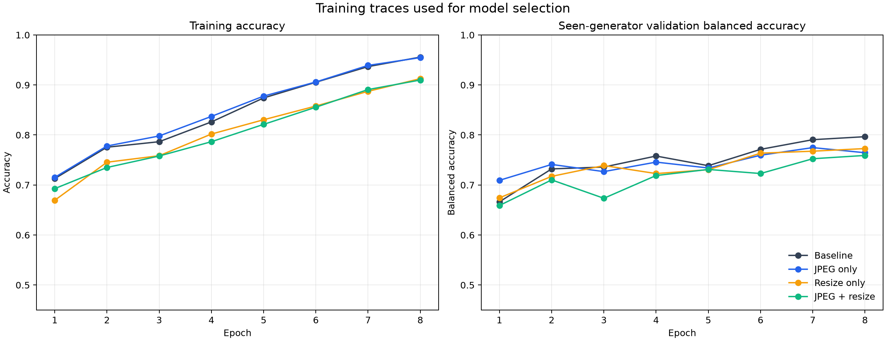
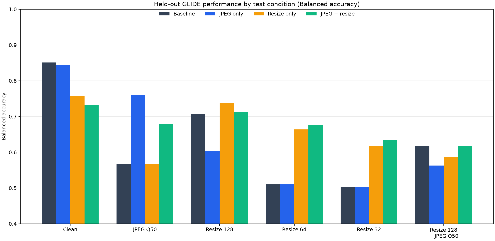
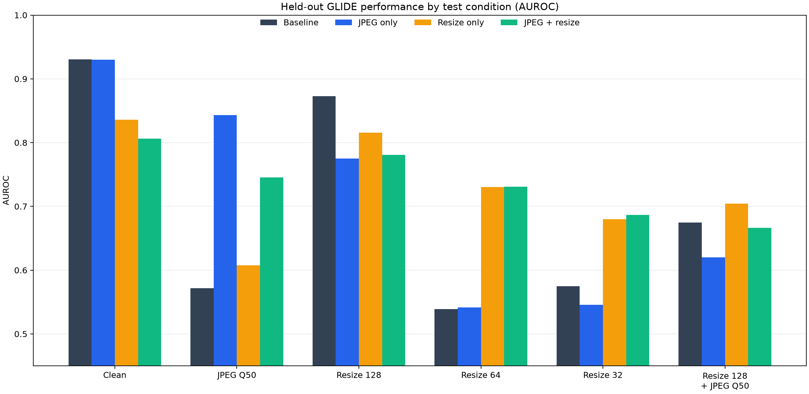

# ResNet-18 Image Generator Holdout and Artifact Augmentation Study

**Project:** SC4001, direction J — detecting AI-generated images across generators  
**Status:** ongoing; results are preliminary and open to revision  
**Dataset:** GenImage in `dataset/image/training/GenImage`  
**Primary holdout:** `imagenet_glide`  
**Runs:** seed 42, 8 epochs, batch size 32

> This report records the work completed to date. It is not a final claim about
> unseen-generator detection. The current comparison uses one held-out
> generator and one seed; more holdouts, seeds, and analyses remain possible.

## 1. Project question and purpose

The project asks whether image detectors trained on AI images from known
generators can detect AI images from a generator they did not encounter during
training. The central concern is **generalization across generator domains**:
an image detector can obtain high scores on familiar generators by learning
generator-specific patterns that do not transfer to a new one.

The first ResNet experiment established a leave-one-generator-out evaluation
with GLIDE held out. The next two experiments introduced JPEG-compression and
downsampling augmentation during training. Their combined result traded some
clean-image accuracy for better scores on several transformed GLIDE images.
That result alone did not show which augmentation caused the changes, so the
current study adds an ablation: train with JPEG augmentation only, resize
augmentation only, or both.

The study therefore asks two related, limited questions:

1. How well does this ResNet-18 transfer from six seen generator categories to
   held-out GLIDE images?
2. Which of the tested training-time artifact augmentations changes performance
   on clean, JPEG-compressed, and downsampled GLIDE images?

The ablation can identify distortion-specific effects in this setup. It does
not by itself establish that an augmentation improves transfer to every unseen
generator.

**Scope note:** a teammate's CIFAKE experiment was mentioned as parallel work,
but its code, settings, and metric files are not in this result set. This report
therefore documents the four ImageNet-AI GLIDE-holdout runs available here;
the CIFAKE result can be added when its reproducible details are available.

## 2. Experiments completed

Four ResNet-18 models were trained or evaluated with the same held-out split,
seed, epoch budget, and evaluation set:

| Run | Training-time artifact augmentation | Selected epoch | Best seen-generator validation balanced accuracy | Test threshold |
|---|---|---:|---:|---:|
| Baseline | None; standard crop and flip | 8 | 79.66% | 0.13410 |
| JPEG only | JPEG quality 30–95, probability 0.5 per image | 7 | 77.48% | 0.19855 |
| Resize only | Downsample shorter side to 32, 64, or 128 px, probability 0.5 | 8 | 77.28% | 0.12998 |
| JPEG + resize | Each artifact independently with probability 0.5 | 8 | 75.91% | 0.16785 |

The combined run was first tested as a single robustness treatment. The two
component-only runs were added to determine whether its effects came from JPEG,
resizing, or their combination. Each model's checkpoint and threshold were
selected using only seen-generator validation data.

### Training curves

The left panel shows fit accuracy. The right panel shows balanced accuracy on
the seen-generator validation set, which selected the checkpoint. These
validation curves are not held-out GLIDE test results.

## 3. Dataset and leakage controls

The dataset contains seven generator folders:

- `imagenet_ai_0419_biggan`
- `imagenet_ai_0419_vqdm`
- `imagenet_ai_0424_sdv5`
- `imagenet_ai_0424_wukong`
- `imagenet_ai_0508_adm`
- `imagenet_glide`
- `imagenet_midjourney`

Each has `train` and `val` directories, with `ai` and `nature` categories.
Each generator category contains 2,000 generated training images and 500
generated validation images. Real ImageNet nature images are shared between
the generator folders, so the script reads a single copy rather than counting
the same photographs multiple times.

The original dataset is stored under `dataset/image/training/GenImage`. The
current held-out GLIDE test files are copied to
`dataset/image/test/GenImage/imagenet_glide/test/{ai,nature}`. The GenImage
source validation files remain in place for future holdout rotations.

For all four reported GLIDE runs, the six non-GLIDE generator folders are the
seen domain and GLIDE is held out:

| Partition | Real images | AI images | Total | Use |
|---|---:|---:|---:|---|
| Fit | 1,600 | 12,000 | 13,600 | Optimize model weights |
| Seen validation | 400 | 3,000 | 3,400 | Select checkpoint and threshold |
| GLIDE test | 500 | 500 | 1,000 | Final held-out evaluation |

The 400 calibration photographs are a reserved 20% of unique real training
images. The shared validation photographs are not used for calibration because
they also occur in the held-out generator's validation folder. The GLIDE
generator's images are excluded from fitting and model selection.

Each test condition is applied to the same 1,000 held-out images. Thus, the six
conditions are six evaluations of repeated images under different image
processing conditions, not 6,000 independent source images.

## 4. Model and training procedure

- **Architecture:** ResNet-18 initialized with ImageNet-pretrained weights;
  replace the final fully connected layer with a two-class output.
- **Labels:** real/nature is the positive class for `p_real`; generated/AI is
  the negative class.
- **Common input pipeline:** resize to 256 pixels, random resized crop to 224
  pixels (scale 0.75–1.0) and random horizontal flip during fitting; ImageNet
  channel normalization. Validation and test use resize to 256 followed by a
  center crop to 224.
- **Optimizer:** AdamW, learning rate `2e-4`, weight decay `1e-4`, with a cosine
  learning-rate schedule; class-weighted cross-entropy loss.
- **Training budget:** 8 epochs, batch size 32, seed 42, 4 data-loader workers.
- **Hardware/software recorded:** NVIDIA GeForce RTX 4050 Laptop GPU; PyTorch
  2.15.0+cu132; torchvision 0.29.2+cu132.
- **Checkpoint selection:** highest balanced accuracy on the seen-generator
  validation set. The threshold that maximizes that same validation balanced
  accuracy is saved with the checkpoint.

The standard fit augmentations are still used for every model. The ablation
changes only the additional artifact augmentation:

| Model | JPEG operation | Resize operation |
|---|---|---|
| Baseline | Off | Off |
| JPEG only | With probability 0.5, encode/decode at random quality 30–95 | Off |
| Resize only | Off | With probability 0.5, downsample shorter side to 32/64/128 px, then enlarge to 256 px |
| JPEG + resize | JPEG operation above | Resize operation above, sampled independently |

The script applies artifact augmentation before random crop and flip. The
validation and test pipelines do not use training-time random augmentation.

## 5. Test conditions and metrics

The GLIDE test set is evaluated in six conditions:

1. **Clean:** original image, standard validation preprocessing.
2. **JPEG Q50:** encode/decode at JPEG quality 50, then standard preprocessing.
3. **Resize 128 / 64 / 32:** set the shorter side to the indicated size using
   bicubic resizing, enlarge the shorter side to 256 while preserving aspect
   ratio, then apply the standard center crop.
4. **Resize 128 + JPEG Q50:** downsample to shorter side 128, JPEG encode/decode
   at quality 50, enlarge to shorter side 256, and apply standard preprocessing.

The threshold is fixed per model across all six conditions. It is calibrated on
seen-generator validation data, never on GLIDE. Since each model has its own
calibrated threshold, balanced accuracy captures its decision performance at
that threshold. AUROC is also reported because it assesses ranking across
thresholds. Every condition has 500 real and 500 fake images, so accuracy and
balanced accuracy have the same value here.

## 6. Held-out GLIDE test results

### Balanced accuracy

| Test condition | Baseline | JPEG only | Resize only | JPEG + resize |
|---|---:|---:|---:|---:|
| Clean | 85.1% | 84.3% | 75.7% | 73.2% |
| JPEG quality 50 | 56.7% | **76.0%** | 56.6% | 67.8% |
| Resize to 128 px | 70.8% | 60.3% | **73.8%** | 71.2% |
| Resize to 64 px | 51.0% | 51.0% | 66.4% | **67.5%** |
| Resize to 32 px | 50.3% | 50.2% | 61.7% | **63.3%** |
| Resize to 128 px + JPEG 50 | **61.8%** | 56.3% | 58.8% | 61.7% |

### AUROC (real is positive; score is `p_real`)

| Test condition | Baseline | JPEG only | Resize only | JPEG + resize |
|---|---:|---:|---:|---:|
| Clean | 0.931 | 0.930 | 0.836 | 0.806 |
| JPEG quality 50 | 0.572 | **0.843** | 0.608 | 0.745 |
| Resize to 128 px | **0.873** | 0.775 | 0.815 | 0.781 |
| Resize to 64 px | 0.539 | 0.542 | 0.731 | 0.731 |
| Resize to 32 px | 0.575 | 0.546 | 0.680 | 0.687 |
| Resize to 128 px + JPEG 50 | 0.675 | 0.620 | **0.704** | 0.666 |

### Per-condition metrics and class recalls

Real recall is the fraction of 500 real images classified as real. Fake recall
is the fraction of 500 generated images classified as fake. Fake F1 treats
generated images as the positive class for that F1 calculation. Balanced
accuracy, AUROC, and fake F1 are taken from each saved run summary; recalls are
calculated from its correct/total counts.

| Model | Condition | Balanced accuracy | AUROC | Real recall | Fake recall | Fake F1 |
|---|---|---:|---:|---:|---:|---:|
| Baseline | Clean | 85.1% | 0.931 | 77.2% | 93.0% | 0.862 |
| Baseline | JPEG Q50 | 56.7% | 0.572 | 77.2% | 36.2% | 0.455 |
| Baseline | Resize 128 | 70.8% | 0.873 | 44.2% | 97.4% | 0.769 |
| Baseline | Resize 64 | 51.0% | 0.539 | 3.4% | 98.6% | 0.668 |
| Baseline | Resize 32 | 50.3% | 0.575 | 0.8% | 99.8% | 0.668 |
| Baseline | Resize 128 + JPEG 50 | 61.8% | 0.675 | 83.4% | 40.2% | 0.513 |
| JPEG only | Clean | 84.3% | 0.930 | 76.4% | 92.2% | 0.854 |
| JPEG only | JPEG Q50 | 76.0% | 0.843 | 75.2% | 76.8% | 0.762 |
| JPEG only | Resize 128 | 60.3% | 0.775 | 23.4% | 97.2% | 0.710 |
| JPEG only | Resize 64 | 51.0% | 0.542 | 7.0% | 95.0% | 0.660 |
| JPEG only | Resize 32 | 50.2% | 0.546 | 1.8% | 98.6% | 0.664 |
| JPEG only | Resize 128 + JPEG 50 | 56.3% | 0.620 | 37.4% | 75.2% | 0.632 |
| Resize only | Clean | 75.7% | 0.836 | 80.2% | 71.2% | 0.746 |
| Resize only | JPEG Q50 | 56.6% | 0.608 | 84.6% | 28.6% | 0.397 |
| Resize only | Resize 128 | 73.8% | 0.815 | 78.0% | 69.6% | 0.727 |
| Resize only | Resize 64 | 66.4% | 0.731 | 78.4% | 54.4% | 0.618 |
| Resize only | Resize 32 | 61.7% | 0.680 | 50.0% | 73.4% | 0.657 |
| Resize only | Resize 128 + JPEG 50 | 58.8% | 0.704 | 92.6% | 25.0% | 0.378 |
| JPEG + resize | Clean | 73.2% | 0.806 | 72.0% | 74.4% | 0.735 |
| JPEG + resize | JPEG Q50 | 67.8% | 0.745 | 70.0% | 65.6% | 0.671 |
| JPEG + resize | Resize 128 | 71.2% | 0.781 | 67.6% | 74.8% | 0.722 |
| JPEG + resize | Resize 64 | 67.5% | 0.731 | 69.0% | 66.0% | 0.670 |
| JPEG + resize | Resize 32 | 63.3% | 0.687 | 49.0% | 77.6% | 0.679 |
| JPEG + resize | Resize 128 + JPEG 50 | 61.7% | 0.666 | 58.0% | 65.4% | 0.631 |

### Reading the ablation

- **JPEG augmentation has a large, targeted effect.** On JPEG Q50, balanced
  accuracy rises from 56.7% to 76.0% and AUROC from 0.572 to 0.843. Clean
  balanced accuracy changes by less than one percentage point (85.1% to
  84.3%), and clean AUROC is effectively unchanged (0.931 to 0.930).
- **Resize augmentation helps with the tested low resolutions.** Relative to
  baseline, resize-only balanced accuracy rises by 15.4 percentage points at
  64 px and 11.4 points at 32 px. The clean score falls from 85.1% to 75.7%.
- **Combining augmentation gives the strongest low-resolution balanced
  accuracy.** The combined run scores 67.5% at 64 px and 63.3% at 32 px. It
  does not retain JPEG-only's result on JPEG Q50 (67.8% vs. 76.0%) and has the
  lowest clean balanced accuracy (73.2%).
- **The combined transformed condition remains difficult.** None of the
  augmentation settings yields a clear improvement over the baseline on the
  128-pixel-plus-JPEG condition. Resize-only has the highest AUROC there
  (0.704), while baseline has the highest balanced accuracy (61.8%).
- **Threshold and ranking can tell different stories.** For example, resize-
  only achieves 58.8% balanced accuracy on the combined condition while its
  AUROC is 0.704. The validation-calibrated threshold gives a conservative
  decision balance that does not fully reflect the ranking performance.

Overall, the evidence supports distortion-specific robustness rather than a
single augmentation that improves every kind of GLIDE input. This is a useful
intermediate result for deciding what to study next, not proof of a general
cross-generator improvement.

## 7. Interpretation limits

1. **One held-out generator:** all final results here are for GLIDE. A larger
   leave-one-generator-out study should rotate the holdout and summarize
   variation across generators.
2. **One random seed:** the current comparisons use seed 42. The differences
   have not been tested for run-to-run variation or statistical uncertainty.
3. **One dataset collection and real-image source:** results may reflect this
   dataset's image composition or collection process.
4. **Only two synthetic artifact families:** JPEG compression and resizing do
   not cover social-media pipelines, color edits, screenshots, cropping, or
   newer image-generation systems.
5. **Separate threshold per model:** every threshold is calibrated on the
   model's seen validation split. This is a fair within-model test protocol,
   but comparisons at one common operating point would answer a different
   question.
6. **Transformation recipes are specific:** JPEG Q50 and the specified
   shorter-side resizing recipes should not be treated as universal proxies for
   image sharing or degradation.
7. **Pretrained initialization:** these are fine-tuned ImageNet-pretrained
   models, not training from scratch.

## 8. Work completed and files

- Implemented a ResNet-18 leave-one-generator-out training/evaluation script
  with configurable holdout, threshold calibration, test corruptions, saved
  checkpoints, histories, summary JSON, and per-image scores.
- Ran the unaugmented GLIDE holdout baseline.
- Ran the JPEG-plus-resize training condition.
- Added and ran the JPEG-only and resize-only ablations.
- Recorded the split, methods, results, caveats, and follow-up directions.
- Added a plot-generation script and three report figures.
- Changed per-image score paths to dataset-relative paths before sharing, and
  updated the training script to avoid writing machine-local absolute paths in
  future reports.

Useful files:

- [`scripts/train_resnet_generalization.py`](scripts/train_resnet_generalization.py) — model training and evaluation.
- [`scripts/make_report_assets.py`](scripts/make_report_assets.py) — portable score export and figures.
- [`RESNET_EXPERIMENT.md`](RESNET_EXPERIMENT.md) — concise experiment notes.
- [`results/`](results/) — text summaries, training histories, and per-image scores for each run.
- [`reports/figures/`](reports/figures/) — graphs embedded in this report and the README.

The result directories contain 6,000 score rows each: 1,000 images for each of
six conditions. Checkpoints are kept locally and excluded from GitHub because
they are approximately 43 MB each. The dataset is also not part of this
repository.

## 9. Open next steps

These are options for continued work; no final direction is selected yet:

1. **Repeat seeds** for the four GLIDE conditions to determine whether the
   observed differences are stable.
2. **Rotate the held-out generator** and compare per-generator and macro-average
   results. This directly tests whether the augmentation finding transfers
   across unseen generator families.
3. **Tune the resize policy** on seen validation data, for example lower
   application probability or fewer severe downscales, while reporting clean
   performance as a co-primary outcome.
4. **Inspect error types** by real/fake class and test condition, then inspect
   representative failures to identify whether the detector is reacting to
   image artifacts or scene/content cues.
5. **Compare operating points** and calibration behavior, since thresholded
   balanced accuracy and AUROC sometimes diverge.
6. **Add other realistic transformations** only with a clear hypothesis and
   fixed test definitions, so each comparison remains interpretable.

Any future experiment should log its holdout generator, seed, split sizes,
training and selection procedure, threshold policy, all test conditions, and
per-class metrics. Keep this report open to additions and corrections as the
project develops.
